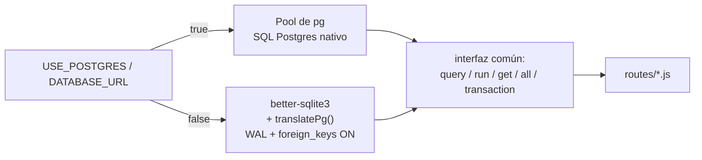
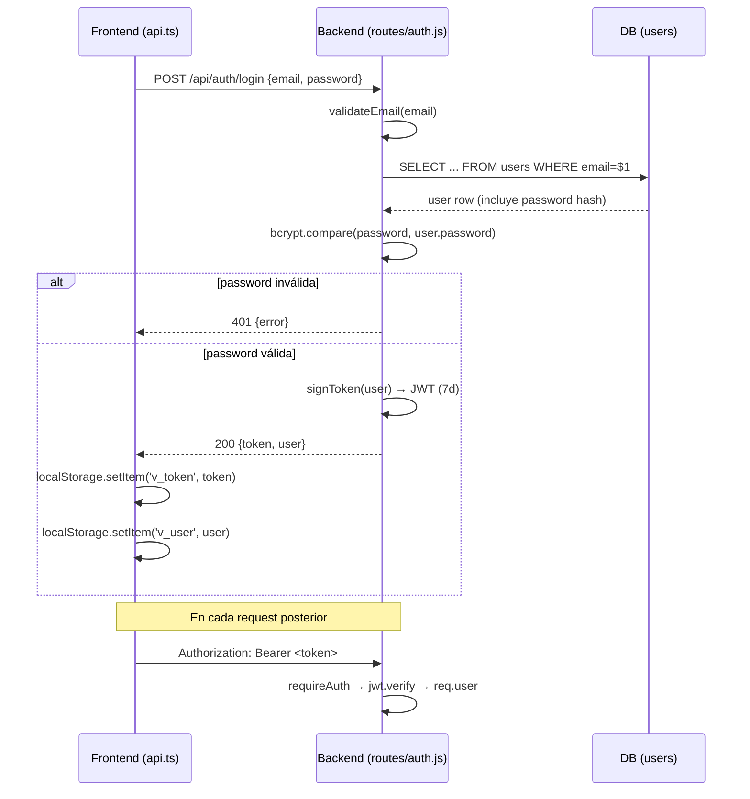

# BACKEND_CONTEXT.md — VoluntariAR API

> Detalle completo del backend Express. Complementa `API_CONTEXT.md` (que documenta cada endpoint individualmente) con la arquitectura, los flujos internos y las convenciones de código.

## 1. Arquitectura del backend

Express monolítico clásico, sin capas de servicio/repositorio: cada archivo de ruta contiene handlers que hacen validación + acceso a datos + formateo de respuesta en el mismo bloque `router.METHOD(...)`.

```
backend/
├── src/
│   ├── index.js            # bootstrap: cors, json parser, montaje de rutas, 404, error handler (lib/errorHandler.js), listen
│   ├── db/index.js         # adaptador dual SQLite/Postgres — único punto de acceso a datos
│   ├── lib/
│   │   ├── email.js          # cliente mínimo de Resend (fetch nativo, sin SDK); isConfigured() para el 503 de §275
│   │   ├── emailTemplates.js # plantillas HTML de los emails transaccionales
│   │   ├── inputs.js         # checkText()/firstError(): textos libres del body (tipo, vacío, largo máximo; §76)
│   │   ├── errorHandler.js   # manejador global de errores: 400/413/415/403 con mensaje fijo en español, resto 500 genérico
│   │   ├── storage.js        # fotos en Cloudinary por REST (subida/borrado firmados, tipo real de imagen, URLs optimizadas)
│   │   └── time.js           # toMillis(): timestamps string (SQLite) o Date (Postgres) → ms
│   ├── middleware/auth.js  # requireAuth, optionalAuth, requireRole, signToken
│   └── routes/
│       ├── auth.js         # /api/auth/*
│       ├── projects.js     # /api/projects/*  (incluye comments, ratings, kpis, recomendaciones)
│       ├── enrollments.js  # /api/enrollments/*
│       ├── ngos.js         # /api/ngos/*      (incluye empleados, patrocinios lado ONG)
│       ├── empresas.js     # /api/empresas/*  (perfil, patrocinios lado Empresa)
│       ├── follows.js      # /api/follows/*   (seguir ONG/proyecto/voluntario, feed)
│       ├── posts.js        # /api/posts/*     ("Momentos": fotos de voluntariados, likes, moderación)
│       ├── projectPhoto.js # PUT /api/projects/:id/photo (la foto del voluntariado, §282; lib/photoUpload.js lee el multipart)
│       ├── voluntarios.js  # /api/voluntarios/* (habilidades, perfil público)
│       ├── faqs.js         # /api/faqs/*      (Chatbot FAQ, sin IA)
│       ├── messages.js     # /api/messages/*   (chat 1 a 1, REST)
│       └── notifications.js# /api/notifications/*
│   └── ws/
│       └── index.js        # servidor de WebSocket (chat en tiempo real), colgado del mismo puerto HTTP
└── scripts/
    ├── migrate.js          # DDL: 33 tablas, 33 índices, datos base (categorías/roles/habilidades/FAQs)
    └── seed.js              # datos de demo idempotentes (se niega con NODE_ENV=production)
```

Rutas de catálogo de solo lectura (`/api/categorias`, `/api/roles`, `/api/habilidades`) están definidas directamente en `src/index.js`, no en un archivo de ruta propio.

## 2. El adaptador de base de datos (`src/db/index.js`)

Pieza central de la arquitectura. Decide en el arranque:

```js
const USE_POSTGRES = process.env.USE_POSTGRES === 'true' || !!process.env.DATABASE_URL;
```

Expone la misma interfaz (`query`, `run`, `get`, `all`, `transaction`, `type`) sin importar el motor subyacente, para que las rutas puedan escribirse una sola vez.

### Rama PostgreSQL
- Usa `pg.Pool`, con `ssl: { rejectUnauthorized: false }` cuando hay `DATABASE_URL` (típico de Render).
- `get()` añade `LIMIT 1` automáticamente envolviendo la query en un subselect si no lo tiene ya.

### Rama SQLite
- Usa `better-sqlite3` (síncrono), con `journal_mode = WAL` y `foreign_keys = ON`.
- **Traduce sintaxis Postgres → SQLite sobre la marcha** vía `translatePg()`: reemplaza `$1,$2...` por `?`, `CURRENT_TIMESTAMP` por `datetime('now')`, `ILIKE` por `LIKE`, y variantes de `ON CONFLICT ... DO NOTHING` por `OR IGNORE`.
- Esta traducción es **regex-based y no exhaustiva**: no traduce `json_agg`, `jsonb_build_object`, `FILTER (WHERE ...)`, `GREATEST`, ni otras funciones específicas de Postgres. Por eso el código de rutas que necesita agregación JSON (ver `projects.js` GET `/`) tiene **dos caminos completamente distintos** según `db.type === 'postgres'`.
- **Placeholders `$N` repetidos:** la traducción de `$1, $2, ...` a `?` no es una simple sustitución 1 a 1 — usa una función `remapParams(sql, params)` que registra a qué índice de parámetro apunta cada aparición de `$N` y arma un array de parámetros alineado a cada `?`. Esto es necesario porque Postgres permite reusar el mismo `$N` más de una vez en una query (p. ej. `WHERE (a=$1 AND b=$2) OR (a=$2 AND b=$1)`), pero el binding posicional de SQLite exige un valor por cada `?`, no por cada número de parámetro único. *(Corregido — antes era una regex simple que rompía en silencio cualquier query con un placeholder reusado, sin lanzar error; ver `PROJECT_ANALYSIS.md §18`, bug B9.)* Al escribir queries nuevas para este adaptador, está bien reusar `$N` — el adaptador ya lo soporta correctamente en ambos motores.



### Transacciones — `db.transaction(async (tx) => { ... })`
> Agregado 2026-09 (`PROJECT_ANALYSIS.md §34`). Antes el adaptador no tenía transacciones.

```js
const outcome = await db.transaction(async (tx) => {
  const swap = await tx.run('UPDATE enrollments SET status=$1 WHERE id=$2 AND status=$3', [new, id, old]);
  if (swap.changes === 0) return 'stale';
  await tx.run('UPDATE projects SET cupos_ocupados = cupos_ocupados + 1 WHERE id=$1', [pid]);
  return 'applied';
});
// emails / notificaciones / llamadas externas (Cloudinary, Mercado Pago): acá, DESPUÉS del COMMIT
```
COMMIT si el callback termina; ROLLBACK y se relanza el mismo error si lanza. Devuelve lo que retorne el callback. `tx` tiene `query/run/get/all` con la misma forma que `db`.

- **Postgres:** toma un cliente del pool y hace `BEGIN/COMMIT/ROLLBACK` sobre ese mismo cliente; si el `ROLLBACK` falla, el cliente se descarta del pool. Nivel de aislamiento: `READ COMMITTED` (default). **Las transacciones corren en paralelo**: por sí solas no evitan que dos requests lean el mismo valor viejo. Para eso: `UPDATE ... SET n = n + 1` atómico o compare-and-swap (`UPDATE ... WHERE status = $viejo` y mirar `changes`). Es el patrón de `enrollments.js`.
- **SQLite:** `better-sqlite3.transaction(fn)` **no sirve** (es síncrono: con un callback `async` haría commit antes de terminar). Se usa `BEGIN`/`COMMIT` a mano. Como hay **una sola conexión**, las transacciones hacen cola y las queries de otras requests **esperan** a que la abierta termine (si no, caerían adentro y se perderían con un ROLLBACK).
- **Reglas que el adaptador hace cumplir con un error (en ambos motores):** usar `tx.*` y nunca `db.*` dentro del callback (en Postgres `db.*` usa otra conexión y quedaría fuera de la transacción; en SQLite quedaría adentro — divergencia que pasaba los tests y rompía producción); no anidar `db.transaction`; no usar `tx` después de que terminó.
- **Reglas que son solo convención:** nada de I/O externo adentro (mantiene la transacción abierta y en SQLite frena a todo el servidor); no envolver `tx.*` en `.catch(() => {})` (una query fallida aborta la transacción entera de Postgres) — lo "best effort" va fuera.

### Diferencias de tipos entre motores (trampas conocidas)
| Dato | SQLite | Postgres | Qué hacer |
|---|---|---|---|
| `SUM` / `COUNT` / `AVG` | número | **string** (bigint/numeric) | `Number()` en el endpoint (`PROJECT_ANALYSIS.md §33`) |
| Columnas de fecha (`created_at`, etc.; todas son `TIMESTAMPTZ`) | string `'YYYY-MM-DD HH:MM:SS'` (UTC, sin zona) | objeto **`Date`** | `toMillis()` de `src/lib/time.js`; nunca `.replace` / `.localeCompare` (`§35`) |

Ambas diferencias devolvían 500 solo en producción (Render) y pasaban todos los tests en SQLite. Por eso existe `npm run test:pg`.

### Fotos (Cloudinary) y publicaciones
`lib/storage.js` habla con la **API REST de Cloudinary con `fetch` nativo**, sin el SDK oficial (mismo criterio que `email.js`: no sumar dependencia ni superficie de `npm audit` por un POST firmado). Firma: parámetros ordenados por código de carácter (comparador explícito, nunca `localeCompare`; sin `file`, `cloud_name`, `resource_type`, `api_key`) + `api_secret` + **SHA-256** (era SHA-1 hasta `PROJECT_ANALYSIS.md §191`; Cloudinary acepta los dos); `test/unit/storage.test.js` verifica cómo se arma el texto firmado contra el **vector de prueba oficial** de la documentación de Cloudinary (publicado en SHA-1, por eso ese test pide SHA-1 explícito). El secreto solo firma: nunca viaja ni se loguea.

| Variable | Efecto |
|---|---|
| `CLOUDINARY_CLOUD_NAME`, `CLOUDINARY_API_KEY`, `CLOUDINARY_API_SECRET` | Las tres hacen falta. Sin ellas, `POST /api/posts` y `PUT /api/auth/me/photo` responden `503` (el resto de la API sigue funcionando) y el arranque muestra `Fotos: sin configurar`. |
| `CLOUDINARY_FOLDER` | Opcional. Vacío = sin carpeta (la subida mínima documentada, más robusta frente a los modos de carpetas de Cloudinary). |

`routes/posts.js` (Momentos) y `routes/auth.js` (foto de perfil, `PUT /api/auth/me/photo`, `PROJECT_ANALYSIS.md §162`; un archivo de hasta 8 MB) llaman a `storage.uploadImage(...)`/`storage.deleteImage(...)` **accediendo a la propiedad en cada llamada** (no desestructurado), para que los tests puedan reemplazarlas sin tocar Cloudinary. Las fotos pasan por `multer` con `memoryStorage` (quedan en memoria solo durante el request, máx. 5 × 8 MB; no se escribe nada en el disco). Reglas del módulo en `AI_RULES.md` regla 24.

**PDF privados para el CV (`PROJECT_ANALYSIS.md §164`):** `storage.detectPdf(buf)` (cabecera real `%PDF-`), `storage.uploadPdf(buf)` → `{ publicId }` (`POST /raw/upload` con `type=private`: **no tiene URL pública**), `storage.pdfDownloadUrl(publicId, { ttlSeconds = 600 })` → `{ url, expiresAt }` (link `GET /raw/download` firmado con `expires_at`; no llama a la red) y `storage.deletePdf(publicId)` (`POST /raw/destroy` con `type=private`; "not found" cuenta como éxito). Las rutas vienen sacadas de la doc oficial del Upload API y del código de `private_download_url` del SDK oficial (cloudinary@2.5.1); la firma es la de `signParams`. Tests: `test/unit/storage-pdf.test.js`. Ningún endpoint los usa todavía (Etapa 4).

### Pagos (Mercado Pago, modo prueba) — `lib/payments.js` (`PROJECT_ANALYSIS.md §169`)
API REST con `fetch`, sin el SDK. Variables: `MP_ACCESS_TOKEN` (sin él, `isConfigured()` es `false`) y `MP_WEBHOOK_SECRET` (sin él, `verifyWebhookSignature` siempre da `false`). Se llama por propiedad (`payments.createPreference(...)`), igual que `storage`, para poder reemplazarlo en los tests.
- `createPreference({ donationId, title, amount, successUrl, notificationUrl })` → `{ preferenceId, checkoutUrl }`: un ítem en ARS, `external_reference` = id de la donación, `X-Idempotency-Key` = id de la donación. Con un token `TEST-` (formato viejo de prueba) devuelve el link de sandbox; con `APP_USR-`, el `init_point`. **En el panel actual las credenciales de prueba también son `APP_USR-`**: con ellas se paga logueado con el usuario comprador de prueba (verificado en producción, §173).
- `getPayment(id)` → `{ id, status, externalReference, amount, currency }`. Es la **única** fuente de verdad sobre si se pagó.
- `verifyWebhookSignature({ xSignature, xRequestId, dataId })` → boolean, nunca lanza.
- `describePaymentsConfig()` → línea para el log de arranque, sin el token ni el secreto.

Los errores son `PaymentError` con `status` y `code` (`not_configured`, `network`, `not_found`, `unauthorized` (401, desde §215), `http`, `bad_response`, `bad_request`, y en OAuth `invalid_grant` y `live_token`). Rutas y firma sacadas del código del SDK oficial `mercadopago@3.6.1` (ver el encabezado del archivo y `BACKEND_ROADMAP_ANALYSIS.md §1.4`).

**Marketplace: cada ONG con su cuenta de vendedor (`PROJECT_ANALYSIS.md §215`, todo en modo prueba).** Variables `MP_CLIENT_ID`, `MP_CLIENT_SECRET` y `MP_OAUTH_REDIRECT_URI` (`isOAuthConfigured()` exige las tres).
- `createPreference({ ..., accessToken })` y `getPayment(id, { accessToken })`: con el token de la ONG la preferencia y la consulta van contra **su** cuenta; sin él, `MP_ACCESS_TOKEN`. Sin `marketplace_fee` (sin comisión, decisión del usuario).
- `authorizationUrl(state)` → `https://auth.mercadopago.com/authorization?client_id&response_type=code&platform_id=mp&state&redirect_uri`.
- `exchangeCode(code)` y `refreshAccessToken(refreshToken)` → `{ accessToken, refreshToken, mpUserId, expiresIn, liveMode: false }`. `POST /oauth/token` en JSON **sin** el access token de la app; el intercambio manda `test_token: true`, la renovación no. **Un token con `live_mode` distinto de `false` se rechaza** (`live_token`). Del cuerpo de un error solo se toma `error` si es un identificador corto: nunca entran al mensaje el code, el secreto ni el resto del cuerpo.

- `getSellerUser(accessToken)` → `{ id, nickname, tags }` (`GET /users/me`): lo usa la carga manual (§216).

**Cuentas de las ONGs — `lib/sellerAccounts.js` (§216).** Único lugar que lee o escribe `ngo_cuentas_mp`:
- `publicAccount(ngoId)` → lo que ve la ONG, sin tokens, o `null`;
- `saveAccount(ngoId, tokens, origin)` → `{ ok }` o `{ conflict }`. Hace un `UPDATE` y, si no hay fila, un `INSERT`, en una transacción. Sube `version` y deja la cuenta `activa`. El `UNIQUE` de `mp_user_id` da `conflict`;
- `deleteAccount(ngoId)` → boolean.
- **`getValidToken(ngoId)` → `{ accessToken, mpUserId, version }`** (§217). Lanza `SellerAccountError` con code `not_linked`, `needs_reconnect` o `unavailable`.
  - Sin vencimiento (carga manual) o con más de 7 días por delante, usa el token tal cual. Si no, lo **renueva** (`payments.refreshAccessToken`) y guarda los tokens nuevos cifrados, porque el refresh token cambia en cada renovación.
  - **Renovaciones a la vez:**
    - en el mismo proceso, una sola por ONG (un `Map` con la promesa en curso);
    - entre procesos, compare-and-swap sobre `version`: el que pierde relee y usa los tokens del otro.
  - **Si Mercado Pago rechaza la renovación** (`invalid_grant`, `live_token`) o el token no se descifra, la cuenta pasa a `requiere_reconexion`. Excepción: si la versión ya cambió, otro proceso renovó primero y no se marca.
  - **Si el error es transitorio**, sigue con el token actual mientras no venza.
- `markNeedsReconnect(ngoId, version)`: compare-and-swap sobre `version`. Después, una notificación `mp_reconnect_needed` a la ONG.
- `findNgoByMpUser(mpUserId)` y `acceptsDonations(ngoId)`: este último es `true` con la cuenta activa.

**Cifrado de los tokens — `lib/tokenCrypto.js` (§215).** `encryptToken(token, ngoId)` / `decryptToken(blob, ngoId)` con AES-256-GCM y la clave `MP_TOKEN_KEY` (32 bytes en base64; `isTokenKeyConfigured()`). Formato `v1:<iv>:<tag>:<cifrado>` en base64url, con el `ngo_id` como dato asociado. Errores `TokenCryptoError` con `code` `not_configured`, `bad_input` o `invalid`, sin el token en el mensaje.

### Emails (Resend) y modo prueba
`lib/email.js` manda por la API de Resend con `fetch` nativo; nunca lanza ni bloquea la respuesta HTTP (fire-and-forget). Eventos que mandan email: nueva inscripción (a la ONG), aprobación y rechazo de inscripción (al voluntario), propuesta de patrocinio (a la ONG) y su respuesta (a la empresa). La configuración se **lee en cada envío** (no al cargar el módulo).

| Variable | Efecto |
|---|---|
| `RESEND_API_KEY` | Sin ella, los emails se omiten (se loguea, no rompe). `test/integration/helpers.js` la fija en `''` dentro de `setupTestServer()` **a propósito**: ningún test debe mandar mails reales aunque tu `.env` tenga una key. |
| `EMAIL_FROM` | Remitente. Default `VoluntariAR <onboarding@resend.dev>` (dominio de pruebas de Resend). |
| `EMAIL_REDIRECT_TO` | **Modo prueba.** Redirige TODO a esa casilla; el destinatario original queda en el asunto (`[para: x@y.com] ...`) y en un aviso al principio del cuerpo (escapado). **Falla cerrado**: si no parece un email, no se manda nada. Vacío = desactivado. |

**Por qué existe:** con `onboarding@resend.dev`, Resend solo entrega al email con el que te registraste en su panel; los usuarios del seed tienen direcciones inventadas y Resend responde `403 Testing domain restriction`. Con `EMAIL_REDIRECT_TO=<tu email de Resend>` todo te llega a vos. Para que cada usuario reciba lo suyo hace falta **verificar un dominio propio** en https://resend.com/domains, definir `EMAIL_FROM` con una dirección de ese dominio y dejar `EMAIL_REDIRECT_TO` vacío.

`describeEmailConfig()` agrega una línea `Email:` al log de arranque (sin la API key) que dice en qué modo está, y advierte si la redirección está activa con `NODE_ENV=production`. Ante ese 403, el log explica **qué hacer** (una vez por proceso) en vez de volcar solo el JSON de Resend.

### Tests contra los dos motores
`npm test` corre todo contra SQLite. `npm run test:pg` corre **la misma suite** contra un Postgres real (`scripts/run-tests-pg.js`; funciona en Windows, sin dependencias extra). Variables: `TEST_PG_HOST`, `TEST_PG_PORT`, `TEST_PG_DB` (default `voluntariar_test`, hay que crearla), `TEST_PG_USER`, `TEST_PG_PASSWORD`. Cada archivo de test crea su propio schema `test_<pid>_<rand>` y lo borra al terminar; **nunca toca `public`** e **ignora `DATABASE_URL`** a propósito. Hay bugs que solo se ven en Postgres (agregados que llegan como string, carreras entre conexiones, `Date` en vez de string): SQLite no los detecta.

**Implicación práctica para cualquier cambio futuro:** cualquier query nueva que use funciones agregadas de JSON, `RETURNING`, o sintaxis avanzada de Postgres debe implementarse dos veces (rama Postgres y rama SQLite) o probarse contra ambos motores. `GET /api/projects` ya hace esto (ver `API_CONTEXT.md`).

## 3. Middleware de autenticación (`src/middleware/auth.js`)

| Función | Comportamiento |
|---|---|
| `requireAuth(req,res,next)` | Exige header `Authorization: Bearer <token>`. Verifica con `jwt.verify`. Si falla → `401`. Si OK → `req.user = payload`. |
| `optionalAuth(req,res,next)` | Igual, pero nunca bloquea: si no hay token o es inválido, simplemente no setea `req.user` y sigue. Usado en endpoints públicos que quieren personalizar la respuesta si el visitante está logueado (p. ej. `GET /projects/:id` para incluir `my_enrollment`). |
| `requireRole(...roles)` | Debe usarse **después** de `requireAuth`. Si `req.user` no existe → `401`; si `req.user.role` no está en la lista permitida → `403`. Acepta arrays o argumentos sueltos (`roles.flat()`). |
| `signToken(user)` | Firma un JWT con payload `{ id, email, role, name }` y expiración `JWT_EXPIRES_IN` (default `7d`). |

`JWT_SECRET` tiene un fallback hardcodeado (`'voluntariar_dev_secret'`) si la env var no está seteada — aceptable en desarrollo, **riesgo de seguridad si se despliega sin configurar `JWT_SECRET`** (ver `PROJECT_ANALYSIS.md`).

## 4. Flujo de login / JWT (diagrama de secuencia)



## 5. Flujo de permisos por endpoint (patrón general)

La mayoría de los endpoints de escritura sobre recursos de una ONG siguen este patrón repetido en `projects.js`, `enrollments.js` y `ngos.js`:

```js
const ngo = await db.get('SELECT id FROM ngos WHERE user_id=$1', [req.user.id]);
const resource = await db.get('SELECT ... WHERE id=$1 AND ngo_id=$2', [req.params.id, ngo?.id]);
if (!resource) return res.status(404 /* o 403 */).json({ error: '...' });
```

Esto acopla la autorización a la consulta de datos (si el recurso no pertenece a la ONG del usuario, el `SELECT` simplemente no devuelve fila, y el endpoint responde 404 en vez de 403 — lo cual es una decisión de seguridad deliberada para no filtrar la existencia del recurso, aunque no está documentada como tal en el código).

## 6. Cómo se construyen las respuestas — funciones `fmt()`

Como el esquema de base de datos está en español (`titulo`, `descripcion`, `ubicacion`, `cupos`...) y el frontend espera inglés (`title`, `description`, `location`, `volunteers_needed`...), cada ruta que devuelve un recurso "de dominio" pasa la fila cruda por una función formateadora local:

- `projects.js::fmt(p)` — mapea proyecto DB → proyecto API, además parsea `roles_json`/`requisitos_json` (strings JSON) a arrays reales con `parseJson()`. Incluye `latitude`/`longitude`/`modality` (agregados 2026-09). **Exportado** (`module.exports.fmt = fmt`) para que otros routers que devuelven proyectos lo reusen en vez de copiarlo — lo importan `follows.js` y `ngos.js` (ver §10, ítem sobre duplicación ya corregida dos veces). Desde REVISION A1 también lo usan los proyectos de `GET /api/ngos/:id` (antes un SELECT propio de 8 campos, sin `duration` ni `hours_per_week`).
- `ngos.js::fmtNgo(n)` — mapea ONG DB → ONG API (`nombre→name`, `foto_perfil→logo`, `banner→cover_image`, `descripcion→description`, `mision→mission`, `ubicacion→location`, `categoria_nombre→category`).
- `empresas.js::fmtEmpresa(e)` — mismo patrón para Empresa (`nombre→name`, `industria→industry`, `categoria_nombre→category`, etc.).
- **Los tres son listas blancas** (`PROJECT_ANALYSIS.md §86`): devuelven solo los campos que nombran, nunca `...fila`. Antes esparcían la fila entera y cualquier columna nueva salía sola por la API. `fmt` deja pasar además los campos que el feed agrega a la fila antes de formatear (`PROJECT_EXTRAS`: `ratings`, `recent_comments`, `comments_count`, `my_enrollment_status`, `follow_source`, `follow_label`). `fmtNgo` se exporta desde `ngos.js` y lo importa `follows.js` (tenía su propia copia). `test/integration/public-columns.test.js` controla las dos mitades: que no salga una columna no elegida y que sí salga todo lo que espera el frontend.

## 7. Helpers y validaciones

| Helper | Ubicación | Qué hace |
|---|---|---|
| `validateEmail/validateName/validatePassword` | `routes/auth.js` | Regex idénticas (copiadas) a las de `frontend/AuthModal.tsx` |
| `validateProject(body)` | `routes/projects.js` | Valida título, descripción, ubicación, duración (si `fugaz`), horas semanales (si `sostenido`), cupos |
| `parseJson(val)` | `routes/projects.js` | `JSON.parse` con try/catch que devuelve `[]` en error |
| `hasBadWord(text)` / `BLACKLIST` | `lib/badWords.js` | Lista fija de 11 palabras ofensivas en español. Compara **palabras completas**, sin mayúsculas ni acentos (`PROJECT_ANALYSIS.md §93`; antes por subcadena). La usan los comentarios de proyectos, los comentarios de las calificaciones (`§104`) y los textos de publicaciones. Copia idéntica en `frontend/src/lib/badWords.ts`; `test/unit/badWords.test.js` exige que las listas sean iguales. |
| `fmt(p)` | `routes/projects.js` (exportado, reusado por `follows.js` y `ngos.js`) | Formateo español→inglés de un proyecto (ver §6) |
| `fmtNgo(n)` / `fmtEmpresa(e)` | `routes/ngos.js`, `routes/empresas.js` | Formateo español→inglés de ONG/Empresa (ver §6) |
| `attachAssoc(q, rows)` | `lib/projectAssoc.js` | Roles, requisitos y categoría de varios proyectos en 3 consultas fijas, escritos en cada fila como los lee `fmt` (`roles_json`, `requisitos_json`, `category_name`). Lo usa `GET /api/ngos/:id` (REVISION A1). El mismo bloque sigue copiado en el listado SQLite de `projects.js` y en `GET /api/follows/project` y `/feed` (sin migrar). |

No existe una carpeta `src/helpers/` ni `src/utils/` — todo helper vive inline en el archivo de ruta que lo usa, lo que produce duplicación entre `projects.js` y el frontend.

## 8. Convenciones para nombres de campos (mapa de traducción)

| Concepto | Columna DB (español) | Campo API/frontend (inglés) |
|---|---|---|
| Proyecto: título | `titulo` | `title` |
| Proyecto: descripción corta | `descripcion` | `description` |
| Proyecto: descripción larga | `descripcion_full` | `full_description` |
| Proyecto: imagen | `foto_perfil` | `image` |
| Proyecto: ubicación | `ubicacion` | `location` |
| Proyecto: tipo (fugaz/sostenido) | `tipo` | `type` |
| Proyecto: cupos totales | `cupos` | `volunteers_needed` |
| Proyecto: cupos ocupados | `cupos_ocupados` | `current_volunteers` |
| Proyecto: meta de financiamiento | `meta_financiera` | `funding_goal` |
| Proyecto: recaudado | `recaudado` | `current_funding` |
| Proyecto: costo por persona | `costo` | `cost_per_person` |
| Proyecto: horas por semana | `horas_semanales` | `hours_per_week` |
| Proyecto: duración | `duracion` | `duration` |
| Proyecto: latitud/longitud | `latitud`, `longitud` | `latitude`, `longitude` (agregados 2026-09) |
| Proyecto: modalidad | `modalidad` | `modality` (`presencial`/`remoto`/`hibrido`, agregado 2026-09) |
| ONG: nombre | `nombre` | `name` |
| ONG: logo | `foto_perfil` | `logo` |
| ONG: portada | `banner` | `cover_image` |
| ONG: descripción | `descripcion` | `description` |
| ONG: misión | `mision` | `mission` |
| ONG: ubicación | `ubicacion` | `location` |
| Inscripción: mensaje del voluntario | `mensaje` | `message` |

Cualquier campo nuevo que se agregue a una tabla debe:
1. Agregarse al `CREATE TABLE` en `migrate.js`.
2. Agregarse (si aplica) al `fmt()`/`fmtNgo()`/`fmtEmpresa()` correspondiente para exponerse en inglés. **Si no se agrega ahí, no sale por la API** (son listas blancas, §86): es a propósito.
3. Agregarse al `interface` correspondiente en `frontend/src/lib/api.ts`.

**Excepción a tener en cuenta:** en `POST /api/projects` y `PUT /api/projects/:id`, el **body de entrada** ya viaja en inglés (`title`, `location`, `type`, `volunteers_needed`, etc.) — la traducción español↔inglés en este endpoint ocurre únicamente en la *respuesta* (`fmt()`), no en la *lectura* del body. Esto es distinto al resto del backend, donde la convención "DB en español" se refleja también en cómo se nombran las variables internas. Es la fuente del bug B5 (`PROJECT_ANALYSIS.md §13`): el código de `validateProject`/`POST`/`PUT` había sido escrito en algún momento leyendo `cupos` (español) del body en vez de `volunteers_needed` (inglés, el nombre real que envía el frontend), lo que impedía crear o editar cualquier proyecto. Al tocar este endpoint, verificar siempre contra `frontend/src/app/components/CreateVoluntariado.tsx` qué nombres de campo realmente viajan en el body.

No hay generación automática de tipos ni contrato compartido (tipo OpenAPI/tRPC) entre backend y frontend — la sincronización es 100% manual.

## 9. Notificaciones (patrón fire-and-forget)

Cada vez que ocurre un evento relevante (nueva inscripción, aprobación/rechazo), el endpoint que lo origina inserta una fila en `notifications` con `.catch(() => {})` para no bloquear la respuesta principal si la notificación falla:

```js
await db.run(`INSERT INTO notifications (...) VALUES (...)`, [...]).catch(() => {});
```

Esto significa que **fallos en la creación de notificaciones son silenciosos** — no hay logging del error, no hay reintento, y el usuario nunca se entera de que no recibió la notificación esperada.

## 10. Problemas detectados (resumen técnico — ver `PROJECT_ANALYSIS.md` para el análisis priorizado)

1. **`projects.js`, `ngos.js` y `empresas.js` definen algunas rutas/exports después de `module.exports = router`.** Funciona porque `module.exports` apunta al mismo objeto `router` que se sigue mutando. Empezó como un patrón confuso (`projects.js` tenía rutas después del export, y `ngos.js` tenía ~~un comentario huérfano que referenciaba rutas de KPIs que en realidad estaban en `projects.js`~~ — ese comentario ya no existe, se limpió al agregar los endpoints de patrocinio), pero pasó a ser el patrón deliberado del proyecto para exportar helpers reutilizables entre routers (`fmt`, `hasBadWord`, `validateProject`) sin crear un módulo `lib/` aparte.
2. ~~**Inconsistencia `message` vs `mensaje`** en el flujo de inscripción~~ — **Corregido.** El backend ahora acepta `message` en `POST /api/enrollments` y expone `mensaje AS message` en todas las lecturas (`GET /my`, `GET /project/:projectId`), manteniendo la columna DB en español. Ver `PROJECT_ANALYSIS.md §13`.
3. ~~**`GET /ngos/:id` y `GET /ngos/me` no hacen JOIN con `ngo_categorias`/`categorias`**~~ — **Corregido.** Ambas rutas ahora traen `categoria_nombre` igual que `GET /ngos`, `fmtNgo()` la mapea a `category`, y `PUT /ngos/me` persiste el cambio de categoría en `ngo_categorias`. Ver `PROJECT_ANALYSIS.md §13`. (Nota: `GET /ngos/:id/dashboard` sigue sin este JOIN — no se usa para mostrar categoría en ninguna pantalla actual.)
4. ~~**`multer` declarado sin uso**~~ — lo usan `routes/posts.js` (§43) y `routes/auth.js` (foto de perfil, §162); está en 2.x (`PROJECT_ANALYSIS.md §37`). `uuid` se eliminó: los IDs tienen `DEFAULT` en SQL, y los endpoints que devuelven la fila recién creada generan el id en el código con `crypto.randomUUID()` (nativo, mismo formato UUID v4; `PROJECT_ANALYSIS.md §40`).
5. **Falta de índice en columnas usadas para búsqueda por `LIKE`** (`projects.titulo`, `projects.descripcion`, `ngos.nombre`) — los índices existentes cubren `ngo_id`, `status`, `tipo`, `ubicacion`, pero las búsquedas de texto libre en `GET /projects?search=` hacen table scan.
6. **La rama SQLite de `GET /projects` no filtra por múltiples categorías via agregación** de la misma forma que Postgres — usa un subquery `IN` distinto, y enriquece roles/requisitos/categoría con 3 queries en batch, mientras que Postgres lo resuelve en una sola query con `json_agg`. Este es el único endpoint con dos implementaciones tan divergentes: ya hubo un bug que solo existía en la rama Postgres (roles y requisitos vacíos, `PROJECT_ANALYSIS.md §52`); `projects-list-shape.test.js` compara la forma del listado con la del detalle en los dos motores.
7. ~~**`follows.js` tenía su propia copia de `fmt()`, desincronizada** (sin `latitude`/`longitude`/`modality`)~~ — **Corregido** (2026-09): ahora importa `fmt` desde `projects.js`. Mismo problema y mismo fix se repitió en `ngos.js` (`GET /me` devolvía proyectos crudos sin pasar por `fmt()`). Ver `PROJECT_ANALYSIS.md §29`.
8. **`GET /api/projects` no tiene paginación real** — el `limit` default es 20 sin tope superior configurado; cualquier consumidor que necesite el catálogo completo debe pasar un `limit` explícito alto, lo cual es un parche, no una solución (falta "cargar más"/scroll infinito real). Causó un bug real en el frontend, ver `PROJECT_ANALYSIS.md §29` bug 4.

## 11. Posibles mejoras

- Extraer los helpers de validación y la blacklist a un módulo compartido (`src/lib/validators.js`, `src/lib/blacklist.js`) para eliminar la duplicación backend/frontend, o mejor, exponerlos vía un endpoint/paquete compartido.
- Introducir un contrato de tipos compartido (OpenAPI generado desde el backend, o un paquete `shared-types` en el monorepo) para que el frontend no dependa de mantener interfaces TS a mano sincronizadas con el `fmt()`.
- Mover la lógica de autorización "recurso pertenece a esta ONG" a un middleware reutilizable en vez de repetirla en cada handler.
- Sustituir el patrón `.catch(() => {})` en notificaciones por logging explícito (aunque se mantenga fire-and-forget).
- Unificar el path SQLite/Postgres de `GET /projects` detrás de una sola query con agregación portable, o documentar explícitamente por qué se bifurca.
