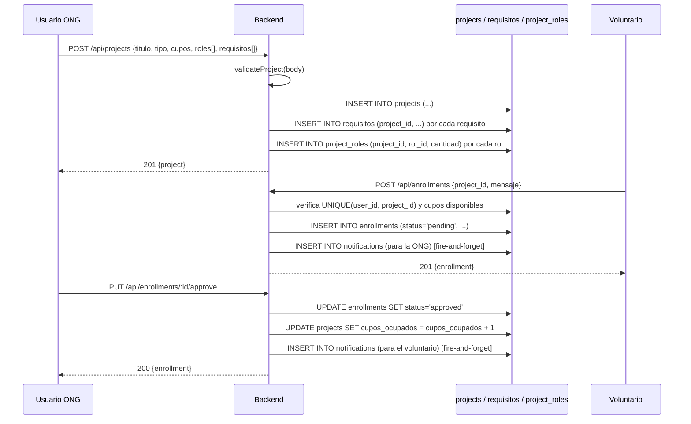

# DATABASE_CONTEXT.md — VoluntariAR

> Esquema completo generado por `backend/scripts/migrate.js` (única fuente de verdad del esquema — no hay migraciones incrementales versionadas, ver `PROJECT_ANALYSIS.md`). Soporta SQLite (local) y PostgreSQL (producción) con tipos adaptados dinámicamente (ver `BACKEND_CONTEXT.md §2`).

## 0. Notas de tipos según motor

| Placeholder en `migrate.js` | SQLite | PostgreSQL |
|---|---|---|
| `UUID_PK` | `TEXT PRIMARY KEY DEFAULT (expresión randomblob)` | `TEXT PRIMARY KEY DEFAULT gen_random_uuid()` |
| `NOW` | `DATETIME DEFAULT (datetime('now'))` | `TIMESTAMPTZ DEFAULT NOW()` |
| `BOOL` | `INTEGER` (0/1) | `BOOLEAN` |
| `JSONB` | `TEXT` | `JSONB` |

Todas las claves primarias son `TEXT` (UUID v4-like), no enteros autoincrementales.

> **⚠️ `created_at` en SQLite tiene resolución de 1 segundo** (`datetime('now')`; en Postgres, microsegundos). Dos filas creadas dentro del mismo segundo **empatan**: `ORDER BY created_at DESC LIMIT 1` devuelve cualquiera de las dos (en la práctica la de menor `rowid`, o sea la más vieja). No usar `created_at` para identificar una fila recién insertada (usar su id) ni asumir un orden estricto entre filas del mismo segundo. Ver `PROJECT_ANALYSIS.md §40`.

## 1. Todas las tablas (34)

| # | Tabla | Propósito |
|---|---|---|
| 1 | `users` | Autenticación y datos base de cualquier usuario (voluntario, ONG, empresa) |
| 2 | `categorias` | Catálogo de categorías temáticas (ambiente, educación, salud, etc.) |
| 3 | `habilidades` | Catálogo de habilidades de voluntarios |
| 4 | `ngos` | Perfil extendido de ONG (1:1 con `users`) |
| 5 | `empresas` | Perfil extendido de empresa (1:1 con `users`) |
| 6 | `voluntarios` | Perfil extendido de voluntario (1:1 con `users`) |
| 7 | `empleados` | Miembros del equipo interno de una ONG |
| 8 | `projects` | Voluntariados/proyectos publicados por una ONG |
| 9 | `requisitos` | Requisitos de un proyecto (tabla normalizada, no JSON) |
| 10 | `roles` | Catálogo de roles de voluntariado (ej. "coordinador de logística") |
| 11 | `kpis` | Indicadores de impacto cargados por la ONG para un proyecto |
| 12 | `enrollments` | Inscripciones de voluntarios a proyectos |
| 13 | `donaciones` | Donaciones monetarias (usuario → proyecto/ONG) |
| 14 | `reuniones` | Reuniones virtuales agendadas para un proyecto |
| 15 | `comments` | Comentarios de usuarios en un proyecto |
| 16 | `ratings` | Calificaciones (1-5) de un usuario a un proyecto |
| 17 | `notifications` | Notificaciones in-app por usuario |
| 18 | `ngo_categorias` | N:M — ONG ↔ Categoría |
| 19 | `project_categorias` | N:M — Proyecto ↔ Categoría |
| 20 | `project_roles` | N:M — Proyecto ↔ Rol (con `cantidad` necesitada) |
| 21 | `voluntario_habilidades` | N:M — Voluntario ↔ Habilidad (con `nivel`) |
| 22 | `empresa_voluntariados` | N:M — Empresa ↔ Proyecto (patrocinio RSE, con `aporte` y `estado`) |
| 23 | `ngo_follows` | N:M — Usuario sigue a ONG |
| 24 | `project_follows` | N:M — Usuario sigue Proyecto |
| 25 | `messages` | Mensajes del chat 1 a 1 (remitente, destinatario, cuerpo, leído) |
| 26 | `empresa_categorias` | N:M — Empresa ↔ Categoría (agregada 2026-09, ver `PROJECT_ANALYSIS.md §24`) |
| 27 | `faqs` | Catálogo del Chatbot FAQ (agregada 2026-09, ver `PROJECT_ANALYSIS.md §27`) |
| 28 | `volunteer_follows` | N:M — Voluntario sigue a otro Voluntario (agregada por el usuario, ver `PROJECT_ANALYSIS.md §28`) |
| 29 | `posts` | Publicaciones ("Momentos"): fotos de un voluntariado, de quien participó o de la ONG dueña (`PROJECT_ANALYSIS.md §43`) |
| 30 | `post_media` | Fotos de una publicación (URL + public_id de Cloudinary + orden) |
| 31 | `post_likes` | Likes de publicaciones (PK compuesta `(post_id, user_id)`) |
| 32 | `account_deletion_tokens` | Códigos de un solo uso para confirmar el borrado de la cuenta (solo el hash; `PROJECT_ANALYSIS.md §177`) |
| 33 | `ngo_cuentas_mp` | Cuenta de Mercado Pago de cada ONG, con los tokens cifrados (marketplace, §216) |
| 34 | `mp_oauth_states` | `state` de un solo uso del OAuth de Mercado Pago (§216) |
| 35 | `patrocinio_puntos` | Puntos de un acuerdo de patrocinio: lo que aporta la empresa y lo que pide u ofrece la ONG (§263) |
| 36 | `patrocinio_mensajes` | La charla de un acuerdo de patrocinio entre la empresa y la ONG (§264) |

## 2. Detalle de columnas por tabla

### `users`
| Columna | Tipo | Restricciones |
|---|---|---|
| id | TEXT | PK |
| name | TEXT | NOT NULL |
| email | TEXT | NOT NULL, UNIQUE |
| password | TEXT | NOT NULL (hash bcrypt) |
| role | TEXT | NOT NULL, DEFAULT `'volunteer'`, CHECK IN (`volunteer`,`ngo`,`company`) |
| avatar | TEXT | La foto de la persona (chat, Momentos, comentarios, reseñas). La escriben `PUT /api/auth/me` y `PUT /api/auth/me/photo` (§162) |
| bio | TEXT | |
| location | TEXT | |
| created_at / updated_at | TIMESTAMP | DEFAULT now |

### `categorias`
id (PK) · nombre (UNIQUE, NOT NULL) · descripcion · icono · created_at

### `habilidades`
id (PK) · nombre (UNIQUE, NOT NULL) · descripcion · created_at

### `ngos`
| Columna | Tipo | Restricciones |
|---|---|---|
| id | TEXT | PK |
| user_id | TEXT | NOT NULL, UNIQUE, FK → `users(id)` ON DELETE CASCADE |
| nombre | TEXT | NOT NULL |
| descripcion, foto_perfil, banner, mision | TEXT | |
| alias | TEXT | UNIQUE |
| ubicacion | TEXT | |
| founded | TEXT | |
| followers | INTEGER | DEFAULT 0, CHECK ≥ 0 |
| created_at / updated_at | TIMESTAMP | |

### `empresas`
Igual forma que `ngos` pero con `industria` en vez de `alias`/`founded`. id · user_id (UNIQUE FK→users) · nombre · descripcion · mision · ubicacion · foto_perfil · banner · industria · followers · created_at · updated_at.

### `voluntarios`
id · user_id (UNIQUE FK→users) · nombre · apellido · descripcion · ubicacion · foto_perfil · banner · cv_url · created_at · updated_at.

> **`cv_url` guarda el `public_id` de un PDF privado de Cloudinary, no una URL** (el nombre de la columna engaña; no se renombró para no tocar el esquema). La escriben `PUT`/`DELETE /api/voluntarios/me/cv` y la lee `GET /api/voluntarios/:userId/cv`, que devuelve un link firmado que vence. Ninguna respuesta la expone (`PROJECT_ANALYSIS.md §164–§165`).
>
> **`foto_perfil` es una copia vieja:** se escribe una sola vez, en el registro (el avatar de iniciales), y nada la actualiza. La foto del voluntario es **`users.avatar`** (decisión F2 de `PLAN_FALTANTE.md`, `PROJECT_ANALYSIS.md §162`). `GET /api/voluntarios/:userId` y las listas de seguidores la siguen devolviendo, pero desde §163 el frontend no la muestra.

### `empleados`
id · ngo_id (FK→ngos, CASCADE) · nombre · apellido · email · foto_perfil · rol (CHECK IN `coordinador`,`comunicador`,`admin`,`otro`, default `coordinador`) · created_at.

### `projects`
| Columna | Tipo | Restricciones |
|---|---|---|
| id | TEXT | PK |
| ngo_id | TEXT | NOT NULL, FK → `ngos(id)` ON DELETE CASCADE |
| titulo | TEXT | NOT NULL |
| descripcion | TEXT | NOT NULL |
| descripcion_full | TEXT | |
| foto_perfil, banner | TEXT | |
| alias | TEXT | UNIQUE |
| tipo | TEXT | NOT NULL, DEFAULT `fugaz`, CHECK IN (`fugaz`,`sostenido`) |
| status | TEXT | NOT NULL, DEFAULT `active`, CHECK IN (`active`,`completed`,`cancelled`) |
| ubicacion | TEXT | NOT NULL |
| fecha_inicio, fecha_fin | TEXT | |
| cupos | INTEGER | NOT NULL, DEFAULT 0, CHECK ≥ 0 |
| cupos_ocupados | INTEGER | NOT NULL, DEFAULT 0, CHECK ≥ 0 |
| meta_financiera | REAL | DEFAULT 0, CHECK ≥ 0 |
| recaudado | REAL | DEFAULT 0, CHECK ≥ 0 |
| costo | REAL | DEFAULT 0, CHECK ≥ 0 |
| horas_semanales | INTEGER | CHECK NULL o > 0 (solo aplica si `tipo='sostenido'`, validado en la app, no en el CHECK) |
| duracion | TEXT | (solo aplica si `tipo='fugaz'`, validado en la app) |
| latitud, longitud | REAL | Agregadas por el usuario (2026-09) vía `ALTER TABLE`, para el mapa (`ProjectMap.tsx`). El API las expone como `latitude`/`longitude` (ver `fmt()` en `routes/projects.js`) |
| modalidad | TEXT | Agregada por el usuario (2026-09), DEFAULT `presencial`, valores usados: `presencial`/`remoto`/`hibrido`. El API la expone como `modality`. **Ojo:** el frontend debe leer siempre este campo tal cual — no re-inferir la modalidad por texto en `ubicacion` (bug real encontrado y arreglado, ver `PROJECT_ANALYSIS.md §29`) |
| followers | INTEGER | DEFAULT 0, CHECK ≥ 0 |
| created_at / updated_at | TIMESTAMP | |

**Nota:** no existe un `CHECK` a nivel de base de datos que impida `cupos_ocupados > cupos` — esa invariante se protege solo en el código de `enrollments.js` al aprobar una inscripción (ver `API_CONTEXT.md`).

### `requisitos`
id · project_id (FK→projects, CASCADE) · descripcion (NOT NULL) · cantidad (DEFAULT 1, CHECK > 0) · tipo (DEFAULT `general`) · created_at.

### `roles`
id · nombre (UNIQUE, NOT NULL) · descripcion · created_at.

### `kpis`
id · project_id (FK→projects, CASCADE) · nombre (NOT NULL) · descripcion · valor (REAL) · tipo_valor (CHECK IN `numero`,`porcentaje`,`texto`,`booleano`, default `numero`; la API ya no acepta `texto` al crear/editar — `valor` es REAL y quedaba vacío —, el CHECK lo mantiene por los que ya existían: `PROJECT_ANALYSIS.md §90`) · unidad · fecha · created_at.

### `enrollments`
| Columna | Tipo | Restricciones |
|---|---|---|
| id | TEXT | PK |
| user_id | TEXT | NOT NULL, FK → `users(id)` CASCADE |
| project_id | TEXT | NOT NULL, FK → `projects(id)` CASCADE |
| status | TEXT | NOT NULL, DEFAULT `pending`, CHECK IN (`pending`,`approved`,`rejected`,`cancelled`) |
| mensaje | TEXT | mensaje del voluntario a la ONG (la columna DB sigue en español; el backend lo recibe/expone como `message` en la API — ver `API_CONTEXT.md` y `PROJECT_ANALYSIS.md §13`) |
| horas_realizadas | REAL | DEFAULT 0, CHECK ≥ 0 |
| created_at / updated_at | TIMESTAMP | |
| — | — | `UNIQUE(user_id, project_id)` → un voluntario no puede inscribirse dos veces al mismo proyecto |

### `account_deletion_tokens` (`PROJECT_ANALYSIS.md §177`)
token_hash (PK, sha256 del código del email) · user_id (NOT NULL FK→users **CASCADE**) · expires_at (TEXT, ISO calculado en JS: no se usa la hora de la base, para no depender del motor ni de la zona) · created_at. Un pedido nuevo borra los anteriores del mismo usuario. Índice `idx_account_deletion_user`.

### `donaciones`
id · user_id (NOT NULL FK→users CASCADE) · project_id (FK→projects, ON DELETE **SET NULL**) · ngo_id (FK→ngos, ON DELETE **SET NULL**) · monto (NOT NULL, CHECK > 0) · fecha (TIMESTAMP) · estado (CHECK IN `pendiente`,`completada`,`fallida`,`reembolsada`, default `completada`) · created_at · **external_id** (id de la preferencia de Mercado Pago) · **external_payment_id** (el pago que la acreditó) · **external_status** (último estado informado por Mercado Pago) · **moneda** (default `'ARS'`). Las cuatro últimas son de §170 y se agregan con `addColumnIfNotExists`; el índice es `idx_donaciones_external` sobre `external_id`. **cobrador_mp_user_id** (§217): la cuenta de Mercado Pago de la ONG con la que se creó la preferencia. NULL quiere decir que se cobró con la cuenta de la aplicación (donaciones de antes de §217). La conciliación y el webhook solo aceptan un pago leído con esa misma cuenta.

> Desde `PROJECT_ANALYSIS.md §170` la usa `routes/donaciones.js` (Mercado Pago). **Ojo con el `DEFAULT 'completada'`**: todo `INSERT` pone `'pendiente'` explícito, y solo `applyPayment` la pasa a `completada` (CAS + `recaudado` en una transacción). `monto` es `REAL` (`float4` en Postgres): por eso las donaciones son en pesos enteros.

### `reuniones`
id · empleado_id (FK→empleados, ON DELETE SET NULL) · user_id (NOT NULL FK→users CASCADE) · project_id (NOT NULL FK→projects CASCADE) · fecha (NOT NULL, AAAA-MM-DD) · horario (NOT NULL, HH:MM) · link · estado (CHECK IN `programada`,`realizada`,`cancelada`, default `programada`) · created_at · **desde §261:** `enrollment_id` (FK→enrollments, ON DELETE CASCADE) · `lugar` · `nota` · `updated_at`.

> Desde §261 la usan las **entrevistas** (`POST`/`PATCH /api/enrollments/:id/entrevista`): una fila por entrevista, atada a la postulación. `user_id` y `project_id` los llena el backend desde la postulación. Índice único parcial `idx_reuniones_una_programada` sobre `enrollment_id` `WHERE estado = 'programada'`: una sola programada por postulación. `empleado_id` sigue sin usarse.

### `patrocinio_puntos`
id · empresa_id · project_id (FK compuesta a `empresa_voluntariados`, ON DELETE CASCADE) · lado (CHECK IN `empresa`,`ong`) · tipo (CHECK IN `dinero`,`insumos`,`voluntarios`,`difusion`,`otro`) · detalle (NOT NULL, hasta 300 por la API) · monto (REAL, CHECK NULL o > 0; solo en `dinero`, privado de las partes) · autor_id (FK→users, SET NULL) · created_at · updated_at. Índice `idx_patrocinio_puntos_acuerdo` (empresa_id, project_id). Se crea en la parte de migraciones aditivas de `migrate.js`, después de las columnas de `empresa_voluntariados` (§263).

### `patrocinio_mensajes`
id · empresa_id · project_id (FK compuesta a `empresa_voluntariados`, ON DELETE CASCADE) · lado (CHECK IN `empresa`,`ong`) · autor_id (FK→users, SET NULL) · cuerpo (NOT NULL, hasta 1000 por la API) · created_at (lo pone el código, con milisegundos: SQLite guarda segundos y el orden de la charla no puede depender del id). Índice `idx_patrocinio_mensajes_acuerdo` (§264).

### `comments`
id · project_id (NOT NULL FK→projects CASCADE) · user_id (NOT NULL FK→users CASCADE) · comment (NOT NULL) · created_at.

### `ratings`
id · project_id (NOT NULL FK→projects CASCADE) · user_id (NOT NULL FK→users CASCADE) · rating (NOT NULL, CHECK 1-5) · comment · created_at · `UNIQUE(user_id, project_id)` (una reseña por usuario y proyecto; está desde el primer `migrate.js`). `POST /api/projects/:id/ratings` se apoya en ese UNIQUE para su `INSERT … ON CONFLICT (user_id, project_id) DO UPDATE` (`PROJECT_ANALYSIS.md §152`): no lo saques sin cambiar la ruta (sin el índice la sentencia falla en los dos motores).

### `notifications`
id · user_id (NOT NULL FK→users CASCADE) · type (NOT NULL) · title (NOT NULL) · body · read (BOOLEAN/INTEGER, default false/0) · data (JSONB/TEXT) · created_at.

### `messages`
id · sender_id (NOT NULL FK→users CASCADE) · receiver_id (NOT NULL FK→users CASCADE) · body (NOT NULL) · read (BOOLEAN/INTEGER, default false/0) · created_at. Sin `UNIQUE` — un mismo par de usuarios puede tener cualquier cantidad de mensajes. Índices en `sender_id`, `receiver_id` y `created_at` (este último para ordenar el historial y la lista de conversaciones).

### `posts`
id · user_id (NOT NULL FK→users CASCADE) · project_id (NOT NULL FK→projects CASCADE) · caption (TEXT, opcional; el límite de 500 caracteres se valida en la API, no en la base) · created_at. Quién puede insertar (inscripción **aprobada** en el proyecto, o la ONG dueña) y el límite de 10 por hora y usuario se imponen en `routes/posts.js`, no con constraints.

### `post_media`
id · post_id (NOT NULL FK→posts CASCADE) · url (NOT NULL; URL base de Cloudinary, **sin** transformaciones: la API le agrega `f_auto,q_auto,...` al responder) · provider_id (NOT NULL; `public_id` de Cloudinary, necesario para borrar el archivo; **nunca se expone por la API**) · position (INTEGER NOT NULL default 0; orden en el carrusel) · width · height · created_at.

### `post_likes`
post_id (NOT NULL FK→posts CASCADE) · user_id (NOT NULL FK→users CASCADE) · created_at · **PK `(post_id, user_id)`**: un usuario no puede dar dos likes al mismo post (la API usa `ON CONFLICT DO NOTHING`, así que repetir el like es idempotente).

### `ngo_cuentas_mp` (Marketplace de Mercado Pago, `PROJECT_ANALYSIS.md §216`)
ngo_id (**PK**, FK→ngos CASCADE) · mp_user_id (NOT NULL **UNIQUE**: una cuenta de Mercado Pago es de una sola ONG) · access_token_cifrado (NOT NULL) · refresh_token_cifrado (NULL si la cargó el script manual) · expires_at (TEXT ISO calculado en JS; NULL si es manual) · estado (CHECK IN `activa`,`requiere_reconexion`, default `activa`) · origen (CHECK IN `oauth`,`manual`, default `oauth`) · version (INTEGER, sube en cada cambio de tokens: la renovación hace compare-and-swap sobre ella) · created_at · updated_at.
**Los tokens están cifrados** (`lib/tokenCrypto.js`, AES-256-GCM con `MP_TOKEN_KEY` y el `ngo_id` como dato asociado). Solo `lib/sellerAccounts.js` lee o escribe esta tabla, y ningún endpoint la devuelve: `public-columns.test.js` lo controla.

### `mp_oauth_states` (§216)
state_hash (**PK**, sha256 del `state`; el `state` en claro nunca se guarda) · ngo_id (NOT NULL FK→ngos CASCADE) · expires_at (TEXT ISO, 10 minutos) · created_at. De un solo uso y a lo sumo uno por ONG (`POST /connect` borra el anterior).

### Tablas intermedias N:M

| Tabla | PK compuesta | Columnas extra |
|---|---|---|
| `ngo_categorias` | (ngo_id, categoria_id) | — |
| `empresa_categorias` | (empresa_id, categoria_id) | — |
| `project_categorias` | (project_id, categoria_id) | — |
| `project_roles` | (project_id, rol_id) | `cantidad` (DEFAULT 1, CHECK > 0) |
| `voluntario_habilidades` | (user_id, habilidad_id) | `nivel` (CHECK IN `basico`,`intermedio`,`avanzado`, default `basico`) |
| `empresa_voluntariados` | (empresa_id, project_id) | desde §263: `version` (INTEGER NOT NULL DEFAULT 1, sube con cada cambio de los puntos), `acepta_empresa_version` y `acepta_ong_version` (INTEGER: la versión que aceptó cada parte; el acuerdo se cierra cuando las dos coinciden con `version`, §264. Proponer guarda `acepta_empresa_version`; `migrate.js` se la pone a las pendientes de antes, una sola vez) · `aporte` (REAL, DEFAULT 0, CHECK ≥ 0), `estado` (CHECK IN `propuesto`,`aceptado`,`rechazado`, default `propuesto` — agregada 2026-09 vía `ALTER TABLE`, ver `PROJECT_ANALYSIS.md §26`), `mensaje`, `created_at`, `updated_at` |
| `ngo_follows` | (user_id, ngo_id) | `created_at` |
| `project_follows` | (user_id, project_id) | `created_at` |
| `volunteer_follows` | (follower_id, following_id) | `created_at`, CHECK `follower_id != following_id` (no autoseguirse) |
| `post_likes` | (post_id, user_id) | `created_at` |

Todas con `ON DELETE CASCADE` en ambas FKs.

## 3. Diagrama Entidad-Relación (Mermaid)

```mermaid
erDiagram
    users ||--o| ngos : "1:1 (si role=ngo)"
    users ||--o| empresas : "1:1 (si role=company)"
    users ||--o| voluntarios : "1:1 (si role=volunteer)"
    users ||--o{ enrollments : "se inscribe"
    users ||--o{ comments : "comenta"
    users ||--o{ ratings : "califica"
    users ||--o{ notifications : "recibe"
    users ||--o{ donaciones : "dona"
    users ||--o{ ngo_follows : "sigue ONG"
    users ||--o{ project_follows : "sigue proyecto"
    users ||--o{ voluntario_habilidades : "tiene"
    users ||--o{ volunteer_follows : "sigue a otro voluntario"
    users ||--o{ posts : publica
    projects ||--o{ posts : "tiene publicaciones"
    posts ||--o{ post_media : "tiene fotos"
    posts ||--o{ post_likes : "recibe"
    users ||--o{ post_likes : da

    ngos ||--o{ projects : "publica"
    ngos ||--o{ empleados : "emplea"
    ngos ||--o{ ngo_categorias : "clasificada en"
    ngos ||--o{ ngo_follows : "es seguida"
    ngos ||--o{ donaciones : "recibe (opcional)"

    empresas ||--o{ empresa_voluntariados : "patrocina"
    empresas ||--o{ empresa_categorias : "clasificada en"

    projects ||--o{ enrollments : "recibe"
    projects ||--o{ requisitos : "requiere"
    projects ||--o{ project_roles : "necesita"
    projects ||--o{ kpis : "mide"
    projects ||--o{ comments : "recibe"
    projects ||--o{ ratings : "recibe"
    projects ||--o{ project_categorias : "clasificado en"
    projects ||--o{ donaciones : "recibe (opcional)"
    projects ||--o{ reuniones : "agenda"
    projects ||--o{ empresa_voluntariados : "patrocinado por"
    projects ||--o{ project_follows : "es seguido"

    categorias ||--o{ ngo_categorias : ""
    categorias ||--o{ project_categorias : ""
    categorias ||--o{ empresa_categorias : ""
    roles ||--o{ project_roles : ""
    habilidades ||--o{ voluntario_habilidades : ""
    empleados ||--o{ reuniones : "coordina (opcional)"

    users {
        text id PK
        text name
        text email UK
        text role "volunteer|ngo|company"
    }
    ngos {
        text id PK
        text user_id FK_UK
        text nombre
    }
    projects {
        text id PK
        text ngo_id FK
        text titulo
        text tipo "fugaz|sostenido"
        text status "active|completed|cancelled"
        int cupos
        int cupos_ocupados
    }
    enrollments {
        text id PK
        text user_id FK
        text project_id FK
        text status "pending|approved|rejected|cancelled"
        text mensaje
        real horas_realizadas
    }
```

## 4. Claves primarias

Las 23 tablas con entidad propia usan `id TEXT PRIMARY KEY` con un default de base (un UUID: `gen_random_uuid()` en Postgres, una expresión equivalente en SQLite). **Ese default no se usa para las altas que devuelven la fila:** el código genera el id con `crypto.randomUUID()`, inserta y relee por ese id (`AI_RULES.md` regla 23, `PROJECT_ANALYSIS.md §40`). Las 10 tablas N:M (`ngo_categorias`, `empresa_categorias`, `project_categorias`, `project_roles`, `voluntario_habilidades`, `empresa_voluntariados`, `ngo_follows`, `project_follows`, `volunteer_follows`, `post_likes`) usan **clave primaria compuesta** sobre las dos FKs (sin columna `id` propia).

## 5. Claves foráneas (resumen de política de borrado)

| Relación | ON DELETE |
|---|---|
| `ngos.user_id → users.id` | CASCADE |
| `empresas.user_id → users.id` | CASCADE |
| `voluntarios.user_id → users.id` | CASCADE |
| `empleados.ngo_id → ngos.id` | CASCADE |
| `projects.ngo_id → ngos.id` | CASCADE |
| `requisitos.project_id → projects.id` | CASCADE |
| `kpis.project_id → projects.id` | CASCADE |
| `enrollments.user_id → users.id` / `.project_id → projects.id` | CASCADE |
| `donaciones.project_id → projects.id` | **SET NULL** |
| `donaciones.ngo_id → ngos.id` | **SET NULL** |
| `donaciones.user_id → users.id` | CASCADE |
| `reuniones.empleado_id → empleados.id` | **SET NULL** |
| `reuniones.user_id → users.id` / `.project_id → projects.id` | CASCADE |
| `comments.*`, `ratings.*`, `notifications.user_id` | CASCADE |
| todas las tablas N:M (18–24, 26) | CASCADE en ambos lados |
| `posts.*`, `post_media.*`, `post_likes.*` | CASCADE: borrar un usuario, un proyecto o un post elimina sus publicaciones, fotos y likes (los archivos en Cloudinary NO se borran solos al borrar un usuario/proyecto: solo al borrar el post por la API) |

Borrar un `user` en cascada elimina: su perfil de ONG/empresa/voluntario, todos sus proyectos (si es ONG, en cascada también borra inscripciones/comentarios/ratings/kpis/requisitos de esos proyectos), sus inscripciones, comentarios, ratings, notificaciones, seguimientos. Es un borrado destructivo total sin soft-delete.

## 6. Índices (22 de 31; el listado completo está en `scripts/migrate.js`)

| Índice | Tabla(columna) | Propósito |
|---|---|---|
| `idx_projects_ngo` | projects(ngo_id) | listar proyectos de una ONG |
| `idx_projects_status` | projects(status) | filtrar activos/completados |
| `idx_projects_tipo` | projects(tipo) | filtrar fugaz/sostenido |
| `idx_projects_ubicacion` | projects(ubicacion) | filtrar por ubicación |
| `idx_enrollments_user` | enrollments(user_id) | inscripciones de un voluntario |
| `idx_enrollments_project` | enrollments(project_id) | inscriptos de un proyecto |
| `idx_enrollments_status` | enrollments(status) | filtrar pendientes/aprobadas |
| `idx_comments_project` | comments(project_id) | comentarios de un proyecto |
| `idx_ratings_project` | ratings(project_id) | calificaciones de un proyecto |
| `idx_notifications_user` | notifications(user_id) | notificaciones de un usuario |
| `idx_notifications_read` | notifications(read) | filtrar no leídas |
| `idx_requisitos_project` | requisitos(project_id) | requisitos de un proyecto |
| `idx_kpis_project` | kpis(project_id) | KPIs de un proyecto |
| `idx_donaciones_user` | donaciones(user_id) | donaciones de un usuario |
| `idx_donaciones_project` | donaciones(project_id) | donaciones de un proyecto |
| `idx_donaciones_external` | donaciones(external_id) | buscar por preferencia de Mercado Pago (§170) |
| `idx_reuniones_project` | reuniones(project_id) | reuniones de un proyecto |
| `idx_reuniones_user` | reuniones(user_id) | reuniones de un usuario |
| `idx_reuniones_una_programada` | reuniones(enrollment_id) WHERE estado = 'programada' (UNIQUE) | una sola entrevista programada por postulación (§261) |
| `idx_empleados_ngo` | empleados(ngo_id) | empleados de una ONG |
| `idx_posts_created` | posts(created_at) | feed de publicaciones por fecha |
| `idx_posts_project` | posts(project_id) | galería de un proyecto |
| `idx_posts_user` | posts(user_id) | publicaciones de un usuario / límite de frecuencia |
| `idx_post_media_post` | post_media(post_id) | fotos de una publicación |
| `idx_post_likes_user` | post_likes(user_id) | "me gusta" de un usuario (la PK ya cubre `post_id`) |

**No hay índices sobre columnas de texto libre usadas en búsquedas `LIKE`/`ILIKE`** (`projects.titulo`, `projects.descripcion`, `ngos.nombre`) — ver `PROJECT_ANALYSIS.md` para el impacto de rendimiento.

## 7. Restricciones (CHECK) notables

- `users.role IN ('volunteer','ngo','company')`
- `projects.tipo IN ('fugaz','sostenido')`, `projects.status IN ('active','completed','cancelled')`
- `enrollments.status IN ('pending','approved','rejected','cancelled')`, `UNIQUE(user_id, project_id)`
- `ratings.rating BETWEEN 1 AND 5`, `UNIQUE(user_id, project_id)`
- Todos los contadores (`followers`, `cupos`, `cupos_ocupados`, `horas_realizadas`, `monto`, `aporte`) tienen `CHECK ≥ 0` (o `> 0` cuando el valor cero no tiene sentido, como `donaciones.monto` o `ratings.rating`).

## 8. Seed (`backend/scripts/seed.js`)

Datos de demostración, **idempotente** (usa `INSERT ... ON CONFLICT DO NOTHING` / `INSERT OR IGNORE` según el motor — vía el helper del adaptador). Crea aproximadamente:

- 3 usuarios voluntarios + 4 ONGs + 1 empresa (con emails y contraseña predecibles para credenciales de demo, documentadas en el `README.md` de la raíz).
- Categorías base (ambiente, educación, salud, animales, etc.) y roles/habilidades de catálogo.
- ~12 proyectos distribuidos entre las 4 ONGs, con requisitos y roles asociados.
- IDs legibles a mano (`user-vol-1`, `ngo-1`, `project-...`) en vez de UUIDs generados, para que las credenciales de demo sean estables entre corridas.

**No corre en producción (`REVISION.md` S9):** con `NODE_ENV=production` (del entorno o del `.env`) sale con código 1 y un mensaje, **antes** de cargar el adaptador de la base (no abre conexión ni toca nada), porque dejaría las 8 cuentas con `Password1` abiertas. Para sembrar una base local con ese `.env`: `NODE_ENV=development npm run db:seed` en Git Bash, o `$env:NODE_ENV='development'; npm run db:seed` en PowerShell (dotenv no pisa una variable ya definida). Al terminar lista las 8 cuentas creadas, la empresa (`admin@techcorp.com`) incluida. Test: `test/integration/seed-production.test.js` (corre el script como proceso hijo, en los dos motores).

## 9. Flujo de creación de datos (alta de un proyecto → inscripción → aprobación)



## 10. Problemas detectados

1. **Sin migraciones incrementales**: `migrate.js` solo sabe crear tablas nuevas (`CREATE TABLE IF NOT EXISTS`). Agregar una columna a una tabla existente en una base ya desplegada requiere escribir un `ALTER TABLE` manual fuera de este script, y no hay ningún mecanismo (tabla de versión, `schema_migrations`) que registre qué cambios ya se aplicaron.
2. ~~**`reuniones` es una tabla "huérfana"**~~ — resuelto en §261 (entrevistas; `donaciones` ya tiene API desde §170). Texto original: existe en el esquema con FKs, CHECKs e índices completos, pero **ningún endpoint del backend la usa**. Indican funcionalidad planificada pero no construida — cualquier IA que trabaje sobre este proyecto no debe asumir que existe un flujo de donaciones o de reuniones solo porque la tabla está.
3. **`cupos_ocupados` no tiene un CHECK que lo limite a `<= cupos`** — la integridad depende enteramente de que el código de aplicación (`enrollments.js`) incremente/decremente correctamente; una escritura directa a la base (o un bug futuro) podría dejar cupos negativos "lógicos" (cupos ocupados mayor a cupos totales) sin que la base de datos lo impida.
4. **Sin soft-delete** en ninguna tabla: todo borrado es físico y en cascada. Borrar una ONG borra permanentemente todo su historial de proyectos, inscripciones, comentarios y calificaciones — sin papelera de reciclaje ni auditoría.
5. **Falta de índices en columnas de búsqueda de texto libre** (ver §6).
6. **Tipos JSON (`notifications.data`) son `TEXT` plano en SQLite**: no hay validación de que el contenido sea JSON válido a nivel de base de datos; se confía en que el backend siempre escriba `JSON.stringify(...)` correctamente.

## 11. Mejoras posibles

- Introducir una tabla `schema_migrations` (o adoptar una herramienta de migraciones como `node-pg-migrate`/`Knex`) para poder versionar cambios de esquema incrementales sin reescribir `migrate.js`.
- Agregar un `CHECK (cupos_ocupados <= cupos)` a `projects` (compatible con ambos motores).
- Decidir si `donaciones`/`reuniones` se implementan pronto o se remueven del esquema hasta que haya un sprint dedicado, para no confundir a futuros desarrolladores/IAs.
- Agregar índices `LIKE`-friendly (o, en Postgres, `pg_trgm`/`GIN`) sobre `projects.titulo`, `projects.descripcion` y `ngos.nombre` si la búsqueda de texto libre se vuelve un caso de uso central.
- Evaluar soft-delete (`deleted_at`) al menos en `users`, `ngos` y `projects`, dado que hoy borrar una cuenta es irreversible y en cascada.
