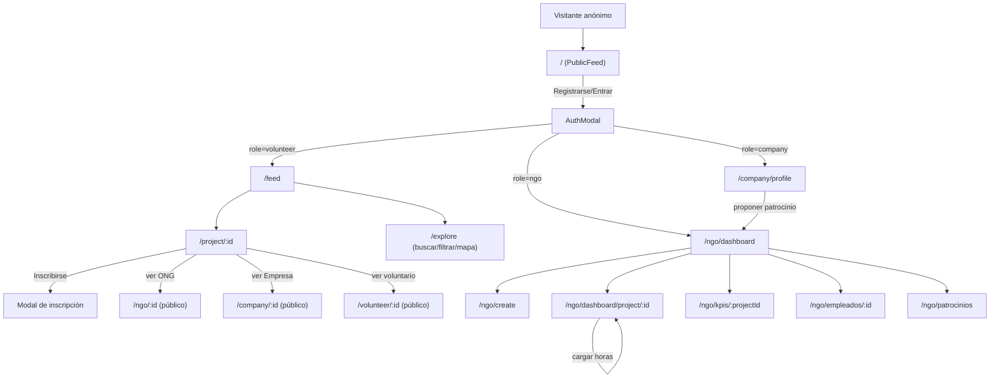

# FRONTEND_CONTEXT.md — VoluntariAR Web

> Detalle completo del frontend React/Vite. Leer junto con `PROJECT_CONTEXT.md §6-7` (navegación general y contrato con backend).

## 0. Rediseño (PROJECT_ANALYSIS §240) — leer primero

El frontend se rehízo según `docs/DESIGN.md` v1.1 y `docs/PLAN_REDISENO_FRONTEND.md` (§239). Lo que cambió en la estructura:

- **Un solo layout para los tres roles: `app/layout/AppShell.tsx`.** `Root`, `NGOLayout` y `CompanyLayout` solo lo envuelven (la ONG y la empresa con `RequireRole`). Tiene la barra inferior (celular), la lateral (escritorio) y `AuthModal`. `ChatProvider` y `UiProvider` están en `main.tsx`, por fuera del router. Los ítems de cada rol salen de **una sola lista**, `app/layout/navConfig.ts` (`NAV[rol].tabs` y `.side`). Se borraron `BottomNav`, `NGOBottomNav`, `NGOSidebarNav`, `CompanyBottomNav`, `CompanySidebarNav` y `ChatbotWidget`.
- **El asistente ya no es un botón flotante:** es una conversación fijada arriba en Mensajes (`AssistantScreen`, rutas `messages/asistente`, `/ngo/messages/asistente` y `/company/messages/asistente`).
- **Configuración (`/settings`, `SettingsScreen`):** CV (voluntario), cuenta de Mercado Pago (ONG, link al perfil), tema (Automático/Claro/Oscuro, `lib/useTheme.ts`, se guarda en `v_theme` y `index.html` lo aplica antes de pintar), privacidad, "Cerrar sesión" (con confirmación) y "Borrar mi cuenta". Los perfiles propios llegan con el ícono de menú (`aria-label="Configuración"`).
- **Kit de interfaz `app/ui/`:**
  - `Button`/`ButtonLink`/`IconButton` (variantes `primary`, `secondary`, `join`, `donate`, `danger`, `text`, `photo`; `busy` + `busyLabel`);
  - `Avatar`: redondo para personas, cuadrado al 28 % para organizaciones; sin foto o con una de DiceBear muestra dos iniciales (`data-initial`), y con `alt` es un `role="img"`;
  - `Meter`/`DualGoal`/`formatMoney`/`pct`: `formatMoney` usa un **espacio duro** (`$\u00A0X`), que los nombres accesibles conservan;
  - `Sheet`: hoja abajo en el celular y diálogo en escritorio, con `closeOnOverlay` y `closeDisabled`;
  - `UiProvider` con `useConfirm()` (diálogo propio) y `useToast()`. Sin proveedor caen a `window.confirm` y `console.warn`; la confirmación es **asíncrona**, así que los tests esperan con `waitFor`;
  - `ProfileHeader`/`ProfileTabs`, `TypeBadge` (azul = Fugaz, verde = Sostenido) y `Logo`/`LogoMark`.
- **`app/volunteering/`:**
  - `cardActions()`: función pura que decide los botones de una tarjeta o de la barra del voluntariado (Inscribirme / Postulado / Vas a ir / No seleccionado / Cupos completos / Ver cómo salió; Donar / Meta cumplida);
  - `VolunteeringTile`: la miniatura de Explorar, Mis voluntariados y "Para vos".
  - `AppShell` monta `ScrollToTop`: una navegación nueva vuelve arriba; "atrás" (POP) y los links con `#ancla` no (D27, §247). Una URL sin pantalla cae en `NotFoundPage` (ruta `*` dentro de Root, con `LoadError`; D28). Notificaciones vacías: el texto depende del rol (`EMPTY_TEXT`, D26).
  - Explorar: "Para vos" muestra hasta 6 recomendaciones y la lista general saca **solo esas**. Antes sacaba las 8 que manda la API y 2 voluntariados no aparecían en ningún lado (D22, §246).
- **Tokens en `styles/theme.css`:**
  - `ink`, `surface`, `canvas`, `hairline`, `brand` (azul, solo dinero), `people` (verde, personas), `critical`, `like` y `star`, con modo oscuro;
  - la paleta vieja de Tailwind (`blue`/`sky`/`indigo` y otras) está remapeada a la escala neutra, así que las pantallas que no se rehicieron toman los colores nuevos sin tocarlas;
  - **ojo con `text-white`:** en oscuro varios tonos se vuelven claros (`violet-600` es `#f2f4f7`, `red-600` es `#ff6b5e`), pero el blanco no cambia. `styles/paletteContrast.test.ts` exige 4,5:1 a todo `text-white` sobre `bg-<color>-<tono>` en los dos modos. Para botones llenos usar tokens: `bg-ink text-on-ink`, `bg-people text-white`, `bg-critical text-on-ink` (§246). El mismo test mide los textos de color con su fondo y los textos sueltos contra `--surface` como **trinquete**: `KNOWN_PAIRS`/`KNOWN_TEXT` listan los casos conocidos de las pantallas sin rehacer; uno nuevo hace fallar el test, y al arreglar uno hay que sacarlo de la lista (§247). Pastillas de estado: `bg-people-soft text-people-text` (aprobado), `bg-surface-soft text-ink-soft` (pendiente), `bg-surface-soft text-critical` (rechazado);
  - fuente Plus Jakarta Sans servida desde `public/fonts`.
- **Pantallas rehechas:**
  - Inicio, con voluntariados y publicaciones mezclados; ya no tiene pestañas, y `FeedTabs` se borró;
  - portada, tarjeta (`FeedPostCard`, "Más información" abre el detalle) y publicación (`PostCard`, con el vínculo al voluntariado y el menú "···");
  - voluntariado (`ProjectDetails`, secciones en vez de pestañas, caja fija en escritorio y barra fija en el celular), Explorar (grilla + botón Mapa/Lista, chips de categoría y una pastilla por filtro);
  - perfiles, Mis voluntariados (cuatro pestañas), Notificaciones (clickeables: `notificationHref`), Mensajes;
  - paneles de la ONG y de la empresa, login/registro (pestañas `role="tab"`), donar (atajos de $ 1.000 a $ 10.000 y "Otro monto") y compositor.
- **Sin rehacer (solo toman la paleta nueva):** `NGOProjectDetail`, `NGOKPIs`, `NGOPatrocinios`, `NGOEmpleados`, `CreateVoluntariado`, `ReviewsModal` y `FilterModal`.

Las secciones de abajo se escribieron antes del rediseño. Donde contradicen esta, vale esta; las líneas que nombran componentes borrados están tachadas o anotadas.

## 1. Arquitectura React

SPA de React 18 + React Router 7 (`createBrowserRouter`, data router API pero **sin usar `loader`/`action`** — toda la carga de datos ocurre en `useEffect` dentro de cada componente, al estilo "clásico"). No hay code-splitting (`lazy`) ni Suspense boundaries de datos. No hay gestor de estado global aparte de `AuthContext`; cada pantalla mantiene su propio estado con `useState`.

```
main.tsx
 └─ <StrictMode>
     └─ <AuthProvider>            (AuthContext.tsx)
         └─ <ChatProvider>         (ChatContext.tsx)
             └─ <UiProvider>       (ui/UiProvider.tsx: confirmaciones y avisos)
                 └─ <RouterProvider> (routes.tsx)
                 ├─ <Root/>          "/", "/feed", "/explore", "/project/:id", "/settings", …
                 ├─ <NGOLayout/>     "/ngo/*"      (RequireRole ngo)
                 └─ <CompanyLayout/> "/company/*"  (RequireRole company)
                    → los tres renderizan <AppShell/> (layout/AppShell.tsx): barra inferior + lateral
                      según el rol (layout/navConfig.ts) + <AuthModal/>
```

## 2. Organización de carpetas

```
frontend/src/
├── main.tsx                  # bootstrap: StrictMode + AuthProvider + RouterProvider
├── app/
│   ├── routes.tsx             # todas las rutas (createBrowserRouter)
│   ├── components/            # pantallas y widgets (más sus *.test.tsx)
│   ├── layout/                # AppShell + navConfig (§240)
│   ├── ui/                    # kit: Button, Avatar, Meter/DualGoal, Sheet, UiProvider, ProfileHeader, TypeBadge, Logo (§240)
│   └── volunteering/          # cardActions (botones según el estado) y VolunteeringTile (§240)
├── lib/
│   ├── api.ts                 # cliente HTTP centralizado + TODOS los tipos TS de dominio (incluye api.posts y el helper de subida multipart)
│   ├── AuthContext.tsx        # sesión global (Context + Provider + hook useAuth)
│   ├── ChatContext.tsx        # chat en tiempo real (WebSocket)
│   ├── format.ts              # timeAgo/formatTime/parseBackendDate (aceptan ISO 8601 y el formato viejo sin zona), truncateText ("ver más"), userMessage (errores para el usuario), normalizeText (comparar sin mayúsculas ni acentos) y otros formatos
│   ├── sponsorship.ts         # etiquetas y colores de los estados de un patrocinio (única fuente: CompanyDashboard, CompanyOwnProfile, NGOPatrocinios)
│   ├── imageCompress.ts       # compresión de fotos en el navegador antes de subirlas (Momentos y foto de perfil)
│   ├── donations.ts           # donaciones: checkDonationAmount (pesos enteros 100–500.000, mensajes del backend), formatPesos y readReturnParams (URL de vuelta de Mercado Pago) — §172
│   ├── cv.ts                  # CV: checkCvFile (PDF, 5 MB, mismos mensajes que el backend) y openCv (link que vence) — §166
│   └── useTheme.ts            # tema claro/oscuro/automático (`v_theme`) — §240
└── styles/
    ├── theme.css               # tokens del DESIGN (claro y oscuro) + paleta vieja de Tailwind remapeada (§240)
    ├── fonts.css               # Plus Jakarta Sans desde public/fonts (§240)
    ├── globals.css             # Tailwind
    └── (assets, fonts)
```

No existen carpetas `hooks/`, `services/`, `types/`, `utils/` separadas — todo vive en `lib/` (6 archivos) y `app/components/` (plano, sin subcarpetas por dominio).

## 3. Todas las páginas (rutas)

| Ruta | Componente | Layout | Rol requerido (solo backend) |
|---|---|---|---|
| `/` | `PublicFeed` | `Root` | Público (redirige si ya hay sesión) |
| `/feed` | `MainFeed` | `Root` | volunteer (feed de lo que sigue, vía `/api/follows/feed`) |
| `/explore` | `ExploreScreen` | `Root` | cualquiera logueado (búsqueda, filtros, mapa) |
| `/project/:id` (alias `/projects/:id`) | `ProjectDetails` | `Root` | público (con `optionalAuth`) |
| `/participation` | `MyParticipation` | `Root` | volunteer |
| `/notifications` | `NotificationsScreen` | `Root` | cualquiera logueado |
| `/momentos` | `MomentsPage` | `Root` | público (una ONG logueada es redirigida a `/ngo/momentos`) |
| `/messages` | `MessagesScreen` | `Root` | cualquiera logueado |
| `/messages/:userId` | `ChatThread` | `Root` | cualquiera logueado |
| `/profile` | `VolunteerProfile` | `Root` | volunteer |
| `/volunteer/:id` | `VolunteerPublicProfile` | `Root` | público |
| `/privacidad` | `PrivacyPage` | `Root` | público. Privacidad y términos (§179); link en el registro, en el pie de `FeedSidebar` y en Configuración |
| `/settings` | `SettingsScreen` | `Root` | con sesión (si no, pide iniciarla). Configuración (§240) |
| `/messages/asistente` (y `/ngo/…`, `/company/…`) | `AssistantScreen` | los tres | el asistente, fijado arriba en Mensajes (§240; reemplaza a `ChatbotWidget`) |
| `/cuenta/borrar` | `DeleteAccountPage` | `Root` | público (el código del link autoriza). Confirmación del borrado de cuenta (§178) |
| `/donaciones/vuelta` | `DonationReturn` | `Root` | con sesión (si no hay, pide iniciarla). Adonde vuelve Mercado Pago (§172) |
| `/ngo/:id` | `NGOPublicProfile` | `Root` | público |
| `/company/:id` | `CompanyPublicProfile` | `Root` | público |
| `/ngo/dashboard` | `NGODashboard` | `NGOLayout` | ngo |
| `/ngo/create` | `CreateVoluntariado` | `NGOLayout` | ngo (guarda `RequireRole` en el layout, §97) |
| `/ngo/dashboard/project/:id` | `NGOProjectDetail` | `NGOLayout` | ngo |
| `/ngo/profile` | `NGOOwnProfile` | `NGOLayout` | ngo |
| `/ngo/mercadopago/vuelta` | `MercadoPagoReturn` | `NGOLayout` | ngo. Adonde vuelve Mercado Pago al vincular la cuenta de la ONG (§218); tiene que coincidir con `MP_OAUTH_REDIRECT_URI` |
| `/ngo/notifications` | `NotificationsScreen inPanel` | `NGOLayout` | ngo (§173: antes la ONG no tenía dónde ver sus notificaciones) |
| `/ngo/patrocinios` | `NGOPatrocinios` | `NGOLayout` | ngo |
| `/ngo/momentos` | `NGOMoments` | `NGOLayout` | ngo (guarda `RequireRole` en el layout, §97) |
| `/ngo/empleados/:id` | `NGOEmpleados` | `NGOLayout` | ngo |
| `/ngo/kpis/:projectId` | `NGOKPIs` | `NGOLayout` | ngo |
| `/ngo/messages` | `MessagesScreen` | `NGOLayout` | ngo |
| `/ngo/messages/:userId` | `ChatThread` | `NGOLayout` | ngo |
| `/company/dashboard` | `CompanyDashboard` | `CompanyLayout` | company |
| `/company/profile` | `CompanyOwnProfile` | `CompanyLayout` | company |
| `/company/messages` | `MessagesScreen` | `CompanyLayout` | company |
| `/company/messages/:userId` | `ChatThread` | `CompanyLayout` | company |

`OnboardingScreen.tsx` (no enrutado) se borró en `PROJECT_ANALYSIS.md §99`, con OK del usuario.

## 4. Todos los componentes (49, sin contar `*.test.tsx`)

### Layouts / navegación
> **§240:** todo este bloque cambió: ver la sección 0. `Root`, `NGOLayout` y `CompanyLayout` solo envuelven `AppShell`; `BottomNav`, `NGOBottomNav`, `NGOSidebarNav`, `CompanyBottomNav`, `CompanySidebarNav` y `ChatbotWidget` se borraron. Lo que sigue queda como historia.

- `Root.tsx` — layout del lado "voluntario/público": `<Outlet/>` + `<BottomNav/>` + `<AuthModal/>` + `<ChatbotWidget/>`. Su barra lateral de escritorio muestra "Cerrar sesión" solo con sesión; sin sesión, "Iniciar sesión" (abre el login; §130).
- `NGOLayout.tsx` — layout del lado "ONG": `<NGOSidebarNav/>` (desktop) + `<NGOBottomNav/>` (mobile) + `<Outlet/>` + `<AuthModal/>` + `<ChatbotWidget/>`.
- `CompanyLayout.tsx` — layout del lado "Empresa", mismo patrón que `NGOLayout` (`CompanySidebarNav`/`CompanyBottomNav`).
- `BottomNav.tsx` — navegación inferior mobile del lado público (`Root`), según el rol. Para empresa usa `COMPANY_NAV_LINKS`, la misma lista de `CompanyBottomNav` (§117). Para ONG usa `NGO_NAV_LINKS`, la misma lista de `NGOBottomNav` (§121).
- `NGOBottomNav.tsx` / `NGOSidebarNav.tsx` — navegación del lado ONG (mobile y desktop respectivamente). `NGOBottomNav` exporta `NGO_NAV_LINKS` (Panel, Crear, Sponsors, Explorar, Mensajes, Mi ONG), la única lista de la barra inferior de la ONG (la usa también `BottomNav`; §121). `NGOSidebarNav` (escritorio) no tiene "Explorar".
- `CompanyBottomNav.tsx` / `CompanySidebarNav.tsx` — navegación del lado Empresa. `CompanyBottomNav` exporta `COMPANY_NAV_LINKS`, la única lista de la barra inferior de empresa (la usa también `BottomNav`).
- `AuthModal.tsx` — modal de login/registro, controlado por estado global de `AuthContext` (`isAuthModalOpen`, `openAuthModal(mode)`). Único punto de entrada de autenticación en toda la app (no hay páginas `/login` o `/register` dedicadas). Redirige según rol al loguearse: `ngo`→`/ngo/dashboard`, `company`→`/company/profile`, `volunteer`→ se queda donde está. En el registro valida la contraseña como el backend: 8+ caracteres, una mayúscula, un número y hasta 72 bytes UTF-8 (`TextEncoder`), con el mismo mensaje (§141). No tiene campo de apellido.
- `ChatbotWidget.tsx` — botón flotante + panel del Chatbot FAQ, montado en los tres layouts. Exporta también `ChatbotSpacer`: el espacio que cada layout pone después del `<Outlet />` para que el botón no tape lo último de la pantalla (no se dibuja en el hilo de un chat, que tiene altura fija; §128).

### Pantallas — lado voluntario
- `PublicFeed.tsx` — feed público sin login, con CTA a registro; los números de la portada salen de `api.stats()` (`GET /api/stats`) con `compactNumber`, y la fila se oculta si todo da 0 o el pedido falla (antes eran fijos e inventados; §129); redirige automáticamente si detecta sesión activa.
- `MainFeed.tsx` — feed autenticado, arma la lista desde `/api/follows/feed` (lo que el voluntario sigue), no desde el catálogo completo. Si falla el feed de seguidos muestra el error con "Reintentar", no el estado vacío; si fallan las ONGs o "mis ONGs", la barra muestra el error de las sugerencias (§110).
- `ExploreScreen.tsx` — sin ningún proyecto dice "Todavía no hay voluntariados publicados", sin hablar de filtros (§131); búsqueda, filtros (`FilterModal.tsx`) y mapa (`ProjectMap.tsx`) del catálogo de proyectos (hasta 500, el tope del backend; avisa si la respuesta viene llena).
- `ProjectMap.tsx` — mapa con Leaflet (gratis, sin API key), pines custom con `L.divIcon`. El mapa chico y el ampliado dibujan pines y punto del usuario con la misma función, `drawMarkers` (solo cambia la duración del paneo: 0.5 s y 0.4 s; §117).
- `FilterModal.tsx` — modal de filtros (categoría, tipo, modalidad, costo) + función pura `filterProjects()` exportada, con tests. La búsqueda y las categorías se comparan sin mayúsculas ni acentos (`normalizeText`, §118).
- `ProjectDetails.tsx` — detalle de un proyecto: info completa, botón de inscripción, comentarios (distinguen si el autor participó, `is_participant`), calificación (solo si `my_enrollment?.status === 'approved'`, con un formulario propio: no usa `ReviewsModal`). Si la persona logueada ya calificó, el formulario se precarga con su reseña (`r.user_id === user.id`), dice "Ya calificaste este voluntariado. Podés editar tu reseña." y el botón, "Actualizar reseña" (el backend hace upsert). La precarga se hace una vez por proyecto y otra después de guardar, nunca si la persona ya tocó el formulario: las recargas por comentar, inscribirse o reintentar no pisan lo que está escribiendo (`PROJECT_ANALYSIS.md §123`). La precarga va en un `useLayoutEffect` (§241): con `useEffect` había un render con la sección visible y el formulario todavía en 5 ★. Reimplementa la blacklist de palabras del backend para validar comentarios en el cliente antes de enviarlos. El campo de comentario tiene `maxLength` 1000, el tope del backend (§151), igual que el de `FeedPostCard`.
- ~~`ProjectCard.tsx`~~ — borrado en §211: ninguna pantalla lo importaba desde `f58b72d` (el feed vertical usa `FeedPostCard`).
- `FeedPostCard.tsx` — tarjeta de post para el feed vertical (like, comentar, inscribirse, calificar vía `ReviewsModal.tsx`).
- `FeedSidebar.tsx` — sidebar de escritorio del feed, puramente presentacional (recibe todo por props, incluidos `suggestionsError`/`onRetrySuggestions`: con error muestra el mensaje y "Reintentar" en vez de "¡Ya seguís a todas…!"; y `followError` (`{ ngoId, message }`, tipo `FollowNgoError`): el error de seguir se muestra debajo de esa ONG).
- `MyParticipation.tsx` — "Mis voluntariados" (§240): cuatro pestañas, Próximos (aprobadas en voluntariados activos), Postulaciones (todas menos las canceladas, con "Cancelar postulación" en el menú "···" y confirmación propia), Seguidos (`api.follows.myProjects`) y Realizados (aprobadas en voluntariados terminados; "Dejá tu reseña" abre `ReviewsModal` con el formulario habilitado, §101). Si hay algo próximo arranca ahí; si no, en Postulaciones. Un error de carga se ve con "Reintentar".
- `VolunteerProfile.tsx` — perfil propio editable, incluyendo selección de habilidades (chips desde el catálogo `api.catalog.habilidades()` + nivel por habilidad, guardado vía `api.voluntarios.habilidades.update`). Si alguna carga falla muestra un aviso con "Reintentar" (recarga todo); cada parte que falló muestra "—" o "No se pudo cargar." en vez de 0 o del vacío, y si no cargaron mis habilidades o el catálogo, guardar el perfil no toca las habilidades (§109).
- `VolunteerPublicProfile.tsx` — perfil público de otro voluntario, con follow/unfollow (si falla, mensaje con `role="alert"` debajo del botón; §114) y sus listas de seguidores/seguidos (`FollowListModal`). La foto es `avatar` (`users.avatar`), nunca `foto_perfil` (copia vieja del registro; decisión F2, §163). Lo mismo en `FollowListModal` (desde §240, el perfil propio ya no tiene la lista "Voluntarios que sigo": se abre desde la estadística "Siguiendo").
- `ProfilePhotoPicker.tsx` — botón "Cambiar foto" de los tres perfiles propios (`VolunteerProfile`, `NGOOwnProfile`, `CompanyOwnProfile`; §163). Comprime con `compressImage`, sube con `api.auth.uploadPhoto` (campo `photo`), actualiza la sesión con `updateUser` y avisa a la pantalla con `onUploaded(url)` (la ONG y la empresa actualizan su `logo` local). Error con `role="alert"`; mientras sube, el botón dice "Subiendo foto…" y queda deshabilitado.
- `NotificationsScreen.tsx` — lista de notificaciones (las últimas 50), marcar todas como leídas. El "N sin leer" y el botón "Marcar todo leído" (así desde §240) usan `unread` de `GET /api/notifications` (total del usuario), no la cuenta de la lista: antes contaba las 50 recibidas y con más de 50 sin leer quedaba corto (`PROJECT_ANALYSIS.md §154`). Mientras carga y si la carga falla, el contador es 0.

**Reseñas:** un solo componente, `ReviewsModal.tsx` (reseñas de otros + formulario si `canRate`). Lo usan el feed (`FeedPostCard`) y "Mis participaciones". Hasta `PROJECT_ANALYSIS.md §101` había además un `ReviewModal.tsx` que hacía lo mismo; se borró con OK del usuario. **Cada vez que se abre pide `GET /api/projects/:id`** (REVISION S3, §112): `initialRatings` solo se muestra mientras llega la respuesta (puede estar vieja; desde §122 las reseñas del feed traen `user_id` y la misma forma que las del detalle). Si la persona logueada ya calificó, el formulario se precarga con su reseña y el botón dice "Actualizar reseña" (S4; el backend hace upsert); mientras carga, el botón está deshabilitado. Un error de carga se ve con `InlineError` y "Reintentar" (S1, §107), y los errores tienen `role="alert"` (S10, §115; el de carga lo pone el propio `InlineError`, §124). `ProjectDetails` tiene su propio formulario con la misma precarga (§123).

### Pantallas — lado ONG
- `NGODashboard.tsx` — lista de proyectos propios + resumen de inscripciones pendientes por proyecto (una sola llamada agregada a `GET /api/ngos/me`, el N+1 que tenía antes ya se resolvió). Cada proyecto muestra su categoría (`{p.category} · Fugaz/Sostenido`); hasta §144 `GET /api/ngos/me` la mandaba vacía y se veía " · Fugaz". En el celular, Equipo y Momentos del encabezado eran solo ícono y el nombre se trunca (§128); desde §240 el encabezado tiene solo la campanita (celular) y "Crear voluntariado" ("Crear" en el celular), y la lista de pendientes se llama "Postulaciones sin responder".
- `CreateVoluntariado.tsx` — formulario de alta/edición de proyecto (mismo componente sirve para crear y editar, diferenciado por `projectId` en query string). Pide modalidad (presencial/remoto/híbrido) y, según la modalidad, ubicación física y/o plataforma digital. Reimplementa validaciones de fecha/cupos/duración ya presentes en el backend. Título, descripción corta y completa tienen los topes del backend (`maxLength` 80, 1000 y 5000), y el paso 1 valida título y descripción también contra lo pegado (§145, §147).
- `NGOProjectDetail.tsx` — detalle de proyecto desde la óptica de la ONG: lista de inscriptos, aprobar/rechazar, cargar horas. El botón "Ver CV de <nombre>" (`openCv(e.user_id)`, §166) aparece solo si la inscripción trae `has_cv: true` (pendiente o aprobada, y con CV; §168). Antes aparecía en todas las pendientes y aprobadas y, sin CV, se abría y cerraba una pestaña vacía. Si el CV se borró después de cargar la lista (404), la fila dice "<nombre> no cargó su CV." con `role="alert"`, sin `alert()`.
- `PrivacyPage.tsx` — `/privacidad` (§179): 8 secciones con `aria-labelledby`. Responsable: "proyecto final de la UCC", sin nombres ni email. **Cada afirmación está verificada en el código** (ver §179): si cambia el comportamiento de la app, hay que cambiar este texto.
- `DeleteAccountSection.tsx` — "Zona peligrosa" → "Borrar mi cuenta" (§178); desde §240 está en Configuración (`SettingsScreen`), no al final de los perfiles. Pide confirmar en la pantalla (`role="group"` "¿Querés borrar tu cuenta?"), avisa a una ONG que se van sus proyectos y las inscripciones, y llama a `api.auth.requestDeletion`. El resultado va con `role="status"`; los errores, con `role="alert"`.
- `DeleteAccountPage.tsx` — `/cuenta/borrar?token=…` (§178). Explica qué se borra; "Sí, borrar mi cuenta" llama a `api.auth.deleteAccount(token)` y cierra la sesión. Si el link venció o es inválido, muestra el mensaje del servidor sin cerrar la sesión.
- `DonateModal.tsx` — hoja "Donar a <proyecto>" (§172; desde §240 usa `Sheet`). Arranca en $ 2.500, tiene atajos ($ 1.000, $ 2.500, $ 5.000 y $ 10.000) y "Otro monto", que muestra un campo libre; el botón dice el monto ("Donar $ 2.500") que se valida con `checkDonationAmount` antes de mandar. Llama a `api.donaciones.create` y redirige a `checkout_url` (la redirección se inyecta con `go`, para los tests). Mientras espera dice "Preparando el pago…"; los errores van con `role="alert"`. Avisa que es modo prueba.
- `DonationReturn.tsx` — `/donaciones/vuelta` (§172). Lee `external_reference` y `payment_id` de la URL (`readReturnParams`) y le pregunta al backend (`api.donaciones.get`), que concilia con Mercado Pago. **Lo que se muestra lo decide el backend**: con `completed` dice "¡Gracias!" con el monto y el proyecto; con `failed`, o con `pending` cuando Mercado Pago avisó rechazo o falta de pago, dice "El pago no se completó"; con `pending`, "Estamos confirmando tu pago". Mientras está pendiente vuelve a preguntar hasta 5 veces cada 3 segundos y después ofrece "Actualizar". También muestra "No encontramos esta donación" (404) y "Iniciá sesión para ver tu donación", y espera a que termine de verificarse la sesión.
- **Notificaciones de la ONG (§173):** `/ngo/notifications` reusa `NotificationsScreen` con `inPanel`, que saca el `md:ml-60`, porque en `NGOLayout` la barra está en el flujo. `NGOSidebarNav` tiene "Notificaciones" con el contador de no leídas (`api.notifications.list`, al montar y al cambiar de pantalla), y `NGODashboard` una campanita con contador en el encabezado, para el celular, porque la barra inferior ya tiene 7 botones.
- `ProjectDetails.tsx` — sin meta de financiamiento pero con donaciones, muestra "Recaudado en donaciones: $X" (§173). Además: botón **"Donar a este proyecto"** en la tarjeta "Progreso del proyecto" (§172), solo si el proyecto está `active` y quien mira no es una ONG. Aparece aunque no haya meta de financiamiento. Un visitante ve "Iniciá sesión para donar"; voluntario o empresa abren `DonateModal`. **Desde §218 el botón solo aparece si `project.accepts_donations`**, es decir, si la ONG vinculó su cuenta de Mercado Pago. Si no, quien no es ONG ve "Esta ONG todavía no recibe donaciones".
- `CvSection.tsx` — "Mi CV" (§166); desde §240 está en Configuración, no en `VolunteerProfile`. Si hay CV sale de `profile.has_cv` de `GET /auth/me`. Permite subir o reemplazar (valida con `checkCvFile` antes de subir), ver (`openCv`) y borrar, con una confirmación en la pantalla (`role="group"` "¿Borrar tu CV?"), sin `window.confirm`. Los avisos van con `role="alert"` y el éxito con `role="status"`. Si no se puede saber si hay CV, dice "No se pudo cargar." y no muestra botones.
- `MercadoPagoAccount.tsx` (§218): dos componentes.
  - **`MercadoPagoAccountSection`** va en el perfil de la ONG, con el ancla `#mercadopago` (hace scroll ahí una vez, cuando carga).
    - Muestra el estado de la cuenta (`api.ngos.mercadopago.get`).
    - "Vincular Mercado Pago" y "Volver a vincular" piden la URL (`connect`) y redirigen; la redirección se inyecta con `go`.
    - "Desvincular" pide confirmación en la página, sin `window.confirm`.
    - Sin OAuth disponible no ofrece vincular.
  - **`MercadoPagoBanner`** es el cartel del panel (`NGODashboard`): aparece solo si falta vincular la cuenta o hay que volver a hacerlo, con un link a `/ngo/profile#mercadopago`. Si la consulta falla, no muestra nada.
- `MercadoPagoReturn.tsx` — `/ngo/mercadopago/vuelta` (§218). Manda `code` y `state` de la URL a `api.ngos.mercadopago.callback` **una sola vez** (un ref la cuida del doble efecto de StrictMode, porque el code es de un solo uso). Muestra el resultado o el error del backend. Sin `code` o sin `state` no llama al backend.
- `NGOOwnProfile.tsx` — perfil de la ONG editable (nombre, descripción, misión, ubicación, categoría). Lista sus proyectos con la categoría de cada uno (de `GET /api/ngos/me`, vacía hasta §144).
- `NGOPublicProfile.tsx` — vista pública del perfil de una ONG (accesible sin login desde `/ngo/:id`), lista sus proyectos activos. "¿Ya la sigo?" (`follows.ngoStatus`) solo lo consulta un voluntario, y se vuelve a cargar si la sesión cambia estando en el perfil (§132); si falla, no muestra el botón Seguir/Siguiendo (sería un "Seguir" falso) sino un aviso `role="alert"` con "Reintentar", que vuelve a preguntar solo eso (§125).
- `NGOPatrocinios.tsx` — propuestas de patrocinio de empresas sobre los proyectos propios: pendientes (aceptar/rechazar) e historial.
- `NGOEmpleados.tsx` — gestión de empleados/miembros del equipo de la ONG, con `api.ngos.empleados` (desde §98; antes `fetch` directo). Un error de carga se muestra con "Reintentar".
- `NGOKPIs.tsx` — CRUD completo (alta/edición/borrado) de indicadores de impacto por proyecto, con resumen visual. Usa `api.projects.kpis.*`.

### Pantallas — lado Empresa
- `CompanyDashboard.tsx` — panel de impacto: 4 KPIs (proyectos patrocinados, propuestas pendientes con contador de rechazadas, horas de voluntariado, voluntarios alcanzados) + lista de proyectos con badge de estado. Horas/voluntarios/cupos solo se muestran en patrocinios `aceptado`. Estado de error con "Reintentar". Usa `api.empresas.dashboard()` y los mapas de `lib/sponsorship.ts`. **No** es la ruta de aterrizaje tras el login (eso sigue siendo `/company/profile`, ver `AuthModal.tsx`).
- `CompanyOwnProfile.tsx` — perfil propio editable + lista de patrocinios propios (proponer, ver estado, retirar uno pendiente). Acepta **`?proponer=<projectId>`** (lo manda el botón "Patrocinar este proyecto" de `ProjectDetails`): abre "Proponer" con ese proyecto elegido y, si no vino en el listado, lo trae con `api.projects.get`; avisa si ya hay una propuesta vigente o si el proyecto no está activo. El listado pide `limit: 500` (sin `limit` el backend devuelve 20). `PROJECT_ANALYSIS.md §66`.
- `CompanyPublicProfile.tsx` — vista pública del perfil de una Empresa, accesible sin login desde `/company/:id`.

### Momentos (publicaciones con fotos) — ver la sección "Momentos" al final
- `MomentsPage.tsx` — `/momentos`: título + `MomentsFeed` (sin `FeedTabs` desde §240; `?crear=1` abre el compositor, es el "Crear" de la navegación). Pública; al visitante le ofrece ingresar; a una ONG la redirige a `/ngo/momentos`; espera a que termine la verificación de sesión (`initializing`) para no parpadear.
- `NGOMoments.tsx` — `/ngo/momentos`, dentro del panel de la ONG (sin pestañas). Solo las publicaciones de los proyectos de **su** ONG: pide `api.ngos.me()` y le pasa `filters={{ ngo_id }}` a `MomentsFeed`; hasta tener el id no muestra el feed (sería el general), sino "Cargando momentos" o un `InlineError` con "Reintentar" (REVISION S2, §113).
- `MomentsFeed.tsx` — lista paginada (carga, vacío, error, "Ver más"), botón "Compartir un momento" y alta/borrado en la lista. Acepta `filters` (`project_id`/`user_id`/`ngo_id`) para las galerías de la Etapa 3 y los Momentos de la ONG.
- `PostCard.tsx` — una publicación: autor, proyecto, carrusel, me gusta optimista con rollback, borrar según `can_delete`, texto con "ver más".
- `PhotoCarousel.tsx` — carrusel (botones, flechas del teclado, deslizar con el dedo).
- `PostComposer.tsx` — modal para publicar (proyecto, hasta 5 fotos con vista previa, texto de hasta 500, compresión, aviso de fotos propias).
- ~~`FeedTabs.tsx`~~ — borrado en §240: el Inicio mezcla voluntariados y publicaciones y ya no tiene pestañas.
- `MomentsGrid.tsx` — grilla de miniaturas (`thumb_url`, 3 columnas, 9 por página) filtrada por `project_id` o `user_id`; al tocar una se abre la publicación completa (`PostCard`) en un modal. Misma paginación y recarga que `MomentsFeed`. Se usa en `ProjectDetails` (galería del proyecto) y `VolunteerPublicProfile` (por id de *usuario*).

### Chat
- `MessagesScreen.tsx` — lista de conversaciones (compartido entre voluntario, ONG y empresa). Desde §240: buscador por nombre (`normalizeText`), el asistente fijado arriba y un punto de no leídos (con la cantidad en su nombre accesible) en vez del contador.
- `ChatThread.tsx` — hilo de una conversación puntual: historial, envío (WS con fallback a REST), marcado automático de leído al abrir.

### Otros
- `ReviewsModal.tsx` — ver la nota de reseñas arriba.
- `LoadError.tsx` — estados de error de carga con "Reintentar"/"Volver" (`describeLoadError`); ver §12 y `PROJECT_ANALYSIS.md §64–§65`. `InlineError` y `LoadError` llevan `role="alert"` propio (en el contenedor, §124): no envolverlos en otro `alert`.
- `Modal.tsx` — modal común accesible (role="dialog", Escape, foco adentro y atrapado, foco devuelto, clic afuera, scroll bloqueado); ver §13 y `PROJECT_ANALYSIS.md §79`.
- `FollowListModal.tsx` — lista "Seguidores"/"Siguiendo" de un voluntario en un `<Modal>`. Recibe `mode`, `load(mode)` (qué endpoint pedir), `emptyText` por modo y `meId` (su fila va a `/profile` y dice "Tú"); pide la lista al abrir. La usan `VolunteerProfile` (mis listas) y `VolunteerPublicProfile` (las de ese voluntario); antes cada uno tenía su copia (`PROJECT_ANALYSIS.md §105`). Si el pedido falla, muestra el error con "Reintentar" (`InlineError`, que ya es un `role="alert"`), nunca el texto de vacío (§108).

## 5. Hooks

No hay hooks custom (no existe `useX.ts` fuera de `useAuth` exportado por `AuthContext.tsx` y `useChat` exportado por `ChatContext.tsx`). Todo el "data fetching" se hace con `useEffect` + `useState` local, repetido componente a componente (patrón: `loading`, `error`, `data` como tres `useState` separados en casi cada pantalla).

## 6. Contexts

Dos contexts: `AuthContext` (`lib/AuthContext.tsx`) y `ChatContext` (`lib/ChatContext.tsx`).

```ts
interface AuthContextValue {
  user: User | null;
  token: string | null;
  loading: boolean;               // true mientras se revalida sesión al montar
  isAuthModalOpen: boolean;
  authModalMode: 'login' | 'register';
  login(email, password): Promise<void>;
  register(data): Promise<void>;
  logout(): void;
  openAuthModal(mode?): void;
  closeAuthModal(): void;
  updateUser(u: User): void;      // reemplaza el usuario (estado + v_user). Existe desde §163; antes este doc lo listaba y el código no lo tenía
}
```

- Al montar, si hay `v_token` en `localStorage`, llama a `GET /api/auth/me` (`initializing` en `true` mientras tanto). OK → usa ese usuario. **Solo cierra la sesión (borra `v_token` y `v_user`) si la respuesta es 401 (token inválido o vencido) o 404 (el usuario ya no existe)**; ante cualquier otro error (sin red, 5xx, el 502 de Render "dormido") conserva el token y sigue con el usuario guardado en `v_user` (`PROJECT_ANALYSIS.md §62`). Antes la cerraba ante cualquier error.
- `login`/`register` llaman a `api.auth.login`/`api.auth.register`, guardan en `localStorage` (`v_token`, `v_user`) y actualizan el estado.
- `logout` es puramente client-side: borra `localStorage` y el estado en memoria. **No invalida el token en el servidor** (no existe endpoint de logout/blacklist).

```ts
interface ChatContextValue {
  conversations: Conversation[];
  unreadTotal: number;
  connected: boolean;             // estado de la conexión de WebSocket
  refreshConversations(): void;
  onMessage(cb): () => void;      // suscripción a mensajes entrantes por WS
  sendViaSocket(to, body): boolean; // intenta mandar por WS; false si no hay conexión
}
```

- Montado en `main.tsx` **dentro** de `AuthProvider` (necesita `useAuth()` para saber cuándo abrir/cerrar el socket).
- Abre la conexión de WebSocket (`new WebSocket(...)`) cuando hay `user`+`token`, la cierra cuando no. Si se corta, reconecta con backoff (1 s, 2 s, 4 s, 8 s, tope 10 s), **salvo con el código 4001** (el servidor rechazó el token): ahí no reintenta (`PROJECT_ANALYSIS.md §71`). La URL se deriva de `BASE` (la misma constante que usa el cliente REST) reemplazando `/api` por `/ws` y `http` por `ws`.
- Mantiene `conversations` refrescándose vía `GET /api/messages/conversations` cada vez que llega un mensaje nuevo por WS, y expone `unreadTotal` (suma de no leídos) para los badges de navegación.
- `onMessage(cb)` permite que `ChatThread.tsx` se suscriba a mensajes entrantes sin que `ChatContext` necesite saber en qué hilo está parado el usuario — el componente filtra por `sender_id`/`receiver_id` él mismo.

## 7. Servicios / API (`lib/api.ts`)

Cliente HTTP centralizado, sin dependencias externas (fetch nativo). Estructura:

```ts
const API_URL = import.meta.env.VITE_API_URL;

async function request(path, options) {
  const token = localStorage.getItem('v_token');
  const res = await fetch(`${API_URL}${path}`, {
    headers: { 'Content-Type': 'application/json',
               ...(token && { Authorization: `Bearer ${token}` }) },
    ...options,
  });
  return readJson(res); // ver abajo
}

// readJson (también lo usa upload()): el cuerpo se lee con res.json().catch(): un proxy puede devolver
// HTML. Si !res.ok → throw new ApiError(data?.error || fallback, res.status), donde fallback es
// "El servidor no está disponible…" para 502/503/504 y "Error del servidor" para el resto. Si es OK pero
// no es JSON → ApiError("Respuesta inesperada del servidor"). Un fallo de red sigue siendo el TypeError
// de fetch (lo traduce userMessage() de format.ts). §62.

export const api = {
  auth: { register, login, me, updateMe, uploadPhoto, requestDeletion, deleteAccount },   // las dos últimas: §178   // uploadPhoto: PUT multipart con upload(form, 'PUT') (§163)
  projects: { list, get, create, update, remove, comment, rate, kpis, recommended... },
  enrollments: { enroll, byProject, byVolunteer, approve, reject, logHours },
  ngos: { list, get, me, updateMe, employees, patrocinios: { list, decide }... },
  empresas: { me, get, update, dashboard, patrocinios: { list, propose, withdraw } },
  follows: { ngo, project, volunteer, feed... },
  donaciones: { create, get },   // §172: get(id, paymentId?) concilia con Mercado Pago
  voluntarios: { cv: { upload, remove, link }, habilidades, getProfile },   // cv: §166 (upload es PUT multipart, campo `cv`)
  faqs: { list, ask },
  notifications: { list, markRead },
};
```

Todos los tipos de dominio (`User`, `Project`, `NGO`, `Empresa`, `Enrollment`, `Notification`, `Faq`, `Patrocinio`, etc.) están definidos como `interface` en este mismo archivo — no hay un módulo `types/` separado.

**Componentes que rompen este patrón:** ninguno desde §98 (el último era `NGOEmpleados.tsx`).

## 8. Modelos TypeScript (resumen — ver `api.ts` para el detalle campo por campo)

| Interface | Corresponde a |
|---|---|
| `User` | fila de `users` (id, name, email, role, created_at) |
| `Project` | proyecto formateado por `fmt()` del backend — incluye `roles: string[]`, `requirements: string[]`, `category?: string`, `latitude?/longitude?`, `modality?`, `my_enrollment?: Enrollment` |
| `NGO` | ONG formateada por `fmtNgo()` — incluye `category?: string` |
| `Empresa` | Empresa formateada por `fmtEmpresa()` — incluye `category?/industry?` |
| `Enrollment` | inscripción: `id, project_id, volunteer_id, status, message?, hours_logged, created_at` |
| `AppNotification` | `id, type, title, body?, read (boolean \| number), created_at` |
| `Faq` | `id, categoria?, pregunta, respuesta` |
| `Patrocinio` | propuesta de patrocinio Empresa↔Proyecto: `empresa_id, project_id, estado, mensaje?, aporte, ...` |
| `CompanyDashboard` | respuesta de `GET /api/empresas/me/dashboard`: `stats`, `impact`, `projects: CompanyDashboardProject[]` (claves en inglés; `sponsorship_status` reusa los valores de `Patrocinio['estado']`) |

## 9. Flujo de navegación (detalle por rol)



## 10. Flujo de autenticación (frontend)

1. Usuario abre `AuthModal` (login o registro) desde cualquier pantalla.
2. Al submit, `AuthContext.login()`/`register()` llama a `api.auth.*`.
3. Éxito → `localStorage.setItem('v_token', ...)`, `setUser(...)`, `closeAuthModal()`.
4. Componentes como `AuthModal` observan `user` vía `useAuth()` y redirigen automáticamente con `navigate()` en un `useEffect` cuando detectan sesión: `ngo`→`/ngo/dashboard`, `company`→`/company/profile`, `volunteer` se queda donde está (normalmente `/`, que ya muestra el feed público).
5. Error → el modal muestra `err.message` (el string ya viene en español desde el backend).

No hay persistencia de "a dónde volver" tras el login — siempre redirige a la home del rol, perdiendo el contexto de si el usuario estaba intentando inscribirse a un proyecto específico.

## 11. Estado global

Limitado a `AuthContext`. No hay estado global de UI (temas, filtros persistentes, carrito, etc.) — cada pantalla resetea sus filtros al desmontar/montar.

## 12. Manejo de errores

- Sin *error boundary* de React en ningún nivel — un throw no capturado en render rompe la pantalla completa (pantalla en blanco), no solo un componente.
- Cada componente atrapa errores de `fetch`/`api.*` con `try/catch` local y los muestra con un `useState<string|null>` propio, normalmente renderizado como texto rojo inline — no hay un sistema de toasts/notificaciones de error.
- **Pantallas que cargan un recurso por id** (`ProjectDetails`, `NGOPublicProfile`, `CompanyPublicProfile`, `NGOProjectDetail`): si la carga falla, muestran **`<LoadError />`** (`components/LoadError.tsx`, con `role="alert"`: la pantalla pasa de "cargando" al error sin mover el foco, §124), nunca `navigate(-1)` + `return null` (abiertas desde un link compartido quedaban en blanco, `PROJECT_ANALYSIS.md §64`). `describeLoadError(err, textoNoExiste)` decide el mensaje: 404 → "no existe" sin reintentar; 403 → mensaje del servidor sin reintentar; 5xx o sin red → con "Reintentar". "Volver" solo aparece si hay página anterior (`history.state.idx > 0`); si no, "Ir al inicio". Una pantalla nueva de ese tipo tiene que usarlo.
- **Listados y secciones de un panel** (`NGOPatrocinios`, `NGODashboard`, `NGOKPIs`, `NotificationsScreen`, patrocinios de `CompanyOwnProfile`, `FollowListModal`, `VolunteerProfile` (un aviso general para sus seis cargas), `MainFeed` (feed y sugerencias; seguir una ONG sugerida bloquea su botón mientras se envía, §126), `ExploreScreen` (con error no dibuja el mapa; si fallan las recomendaciones avisan dentro de "Para vos" con su propio "Reintentar" y el catálogo se ve igual, §111)): si la carga falla muestran **`<InlineError />`** (mismo archivo, mensaje + "Reintentar"), que ya se anuncia (`role="alert"` en su contenedor; no envolverlo en otro, quedarían dos anidados, §124), **nunca el estado vacío**: antes un error se veía como "Sin notificaciones" o "Todavía no hay patrocinios" (`§65`). Si una acción falla (decidir un patrocinio, retirar una propuesta, marcar como leídas), el mensaje se muestra con `role="alert"`. `NGODashboard` va al inicio solo con un 401 (`ApiError.status`), ya no buscando "Token" en el texto.
- **Seguir/dejar de seguir** (perfiles públicos de voluntario y ONG, tarjeta del feed, sugerencias de Inicio): si falla, mensaje breve con `role="alert"` junto al botón, con `userMessage(err, FOLLOW_ERROR)` (`lib/format.ts`), y el estado queda como estaba (`PROJECT_ANALYSIS.md §114`).
- No hay reintento automático. Manejo de 401: `AuthContext` al recargar (§62) y `NGODashboard` (por `ApiError.status`, §65).

## 13. Convenciones de componentes

- Cada componente es un archivo `.tsx` con export nombrado (no default), nombrado igual que el archivo.
- Sin `React.memo`, sin `useCallback`/`useMemo` — no hay optimizaciones de re-render (razonable dado el tamaño de la app).
- Sin PropTypes ni `interface Props` compartida — cada componente define su propio `Props` inline si recibe alguna (la mayoría son "screen-level" y no reciben props, solo leen `useParams()`/`useAuth()`).

- **Layouts (`Root`, `NGOLayout`, `CompanyLayout`):** el `div` exterior lleva `flex-shrink-0`. `#root` es un flex en columna, y sin eso el layout se encogía al alto de la pantalla y el contenido se desbordaba: lo último quedaba debajo de la barra inferior y del botón del chatbot aunque se bajara hasta el final (§128). Después del `<Outlet />` va `<ChatbotSpacer />`.
- **Modales: usar `<Modal>`** (`components/Modal.tsx`), nunca un `<div className="fixed inset-0">` propio. Pasarle un nombre (`labelledBy` con el id del título, o `label`) y las clases de fondo/panel; Escape, foco y Tab ya los resuelve. Lo usan **todos** los modales: `AuthModal`, `ReviewModal`, `ReviewsModal`, `FilterModal`, el mapa ampliado de `ProjectMap`, `PostComposer`, el visor de `MomentsGrid` y las listas de seguidores (`FollowListModal`, que usan `VolunteerProfile`/`VolunteerPublicProfile`) (`PROJECT_ANALYSIS.md §79`, `§81` y `§105`). No agregar listeners de Escape en `window`: cerrarían también el modal de abajo cuando hay dos abiertos. Si cerrar puede perder datos (`PostComposer`, el visor de `MomentsGrid`), `closeOnOverlay={false}` y que `onClose` pase por la confirmación. `FilterModal` y `ProjectMap` lo envuelven en `createPortal` (z-index sobre Leaflet). `ChatbotWidget` no es modal (panel flotante): `role="dialog"` sin `aria-modal`, Escape y foco propios.
- **Nombres accesibles (`PROJECT_ANALYSIS.md §80`):** todo botón que solo muestra un ícono lleva `aria-label` ("Cerrar", "Volver", "Enviar mensaje"…); si actúa sobre un ítem de una lista, el nombre dice cuál (`Aprobar a ${nombre}`, `Editar KPI ${nombre}`). Los botones que alternan un estado usan `aria-pressed` con nombre fijo ("Mostrar contraseña", las estrellas: "3 estrellas"). Todo `input`/`select`/`textarea` lleva `aria-label` con el **mismo texto que su etiqueta visible** (los `<p>`/`<label>` de arriba no están asociados), o uno que diga su función si no tiene etiqueta; el `placeholder` no cuenta como etiqueta. `A11yNames.test.tsx` lo controla pantalla por pantalla: una pantalla nueva con formularios o íconos se suma ahí.
- **Etiquetas asociadas y tarjetas que se abren con el teclado (`PROJECT_ANALYSIS.md §203`, SonarCloud S6853/S6848):** un `<label>` visible va con `htmlFor` y su campo con el mismo `id` (además del `aria-label`, que se mantiene: el texto visible puede tener "*" u "(opcional)"). Un título de un grupo de botones (Categoría, Modalidad, Habilidades, los filtros) es un `<p>`, no un `<label>`. Una tarjeta que lleva a otra pantalla es un `<Link to=…>`, no un `div` con `onClick`: así se enfoca con Tab y se abre con Enter. `CreateVoluntariadoLimits.test.tsx` busca cada campo por el texto visible de su etiqueta y `ExploreScreen.test.tsx` exige que las tarjetas sean links.
- **Respuestas viejas (`PROJECT_ANALYSIS.md §83`):** si un `useEffect` carga datos según un parámetro que puede cambiar sin desmontar la pantalla (`:id`/`:userId` de la URL, una categoría, una búsqueda), la respuesta de un pedido anterior no puede pisar a la del actual. En el effect: `let cancelled = false`, `if (!cancelled)` antes de cada `set…` (también en `catch` y `finally`) y `return () => { cancelled = true; }` (como `ChatThread`, `VolunteerPublicProfile`, `PostComposer`). Si la carga se dispara desde varios lugares (el effect, "Reintentar", recargar tras una acción), `useLatestRequest()` (`lib/useLatestRequest.ts`): `const req = latest.start()` y `if (latest.isLatest(req))` antes de cada `set…` (también en `catch` y `finally`). Lo usan `PublicFeed`, `ProjectDetails`, `NGOPublicProfile`, `CompanyPublicProfile`, `NGOProjectDetail`, `NGOKPIs` y `NGOEmpleados` (§89). Los indicadores de carga llevan `role="status"` con nombre.

## 14. Convenciones de estilos

- Tailwind CSS 4 utilitario, clases inline en el JSX (no hay CSS Modules ni styled-components).
- `styles/globals.css` define variables de tema (colores, radios, fuentes) como custom properties CSS, consumidas por las clases de Tailwind vía `@theme` (Tailwind 4).
- Iconografía consistente con `lucide-react`.
- No hay un sistema de componentes UI compartido (no hay `Button.tsx`, `Card.tsx`, `Input.tsx` genéricos) — cada pantalla reescribe sus propios `<button className="...">` con las mismas clases repetidas copy-pasteadas. Esto es consistente con el origen "Figma-to-code" del proyecto (ver `PROJECT_CONTEXT.md §11`).

## 15. Problemas detectados

1. ~~**`OnboardingScreen.tsx` no está enrutado**~~ — borrado en §99.
2. ~~**`NGOEmpleados.tsx` evita `api.ts`**~~ — **resuelto en `PROJECT_ANALYSIS.md §98`**: usa `api.ngos.empleados`.
3. ~~**Dos componentes de reseña que hacen lo mismo**~~ — consolidados en `ReviewsModal` (§101).
4. ~~**Sin guardas de rol/ruta en el frontend**~~ — **resuelto en `PROJECT_ANALYSIS.md §97`**: `NGOLayout` y `CompanyLayout` envuelven todo en `<RequireRole role=…>` (`components/RequireRole.tsx`). Mientras se verifica la sesión, "cargando"; sin sesión, al inicio con el login abierto; con otro rol, al inicio de ese rol (`homeFor`). Al cerrar sesión desde el panel no se abre el login. Es solo experiencia de uso: la autorización sigue en el backend (regla 15).
5. **Sin paginación real en `ExploreScreen.tsx`**: pide un solo bloque con el tope del backend (`limit: 500`, `EXPLORE_LIMIT`; antes `200`) y filtra en el cliente. `GET /api/projects` no devuelve el total: si la respuesta viene llena se muestra el aviso "Se muestran los primeros 500 voluntariados…" (`PROJECT_ANALYSIS.md §119`). Con más de 500 proyectos activos haría falta "cargar más" y búsqueda en el servidor. Ver `§29` bug 4 y `§96`.
6. **Validaciones duplicadas** (regex de email/password/nombre en `AuthModal.tsx`, lista de palabras en `lib/badWords.ts`, con su igualdad controlada por un test del backend desde §93) que deben mantenerse sincronizadas con el backend.
7. **Sin manejo centralizado de expiración de sesión** — un 401 en medio de la navegación no redirige consistentemente al login en todas las pantallas.
8. **Cobertura (`PROJECT_ANALYSIS.md §185`):** `npm run test:coverage` (proveedor v8, configurado en `vite.config.ts`) mide todo `src/` salvo los tests y `src/test/`. Al 2026-10-17 (CI #19): líneas 90,11 %, sentencias 86,36 %, ramas 81,18 %, funciones 82,11 %; **umbral bloqueante del 80 % en las cuatro** (§212). `lib/api.ts` lo cubre `lib/api.contract.test.ts` (§209). Los que más ramas tienen sin cubrir: `ProjectMap`, `CreateVoluntariado` y `ProjectDetails`.
9. **Componentes sin test propio** (sin `<Componente>.test.tsx`; 22 de 49 al 2026-10-15, después de §107–§119). Algunos tienen tests de un aspecto puntual en otro archivo (entre paréntesis): `ChatThread`, `CompanyBottomNav` (`BottomNav`), `CompanyLayout`, `CompanySidebarNav`, `CreateVoluntariado`, `FeedPostCard` (`FollowErrors`), `FeedSidebar` (`MainFeedErrors`), `FollowListModal` (`FollowLists`), `MainFeed` (`FeedTabsPlacement`, `MainFeedErrors`), `MessagesScreen`, `MyParticipation` (`MyParticipationReview`), `NGOBottomNav` (`BottomNav`), `NGOLayout` (`routes`), `NGOOwnProfile`, `NGOProjectDetail` (`LoadErrorScreens`, `MomentsPlacement`), `NGOPublicProfile` (`LoadErrorScreens`, `routes`, `FollowErrors`, `NGOFollowStatus`), `NotificationsScreen` (`NotificationsTime`, `SwallowedErrors`), `ProjectDetails` (`EnrollStatusLabel`, `NgoPanelLink`, `SponsorPreselect`, `LoadErrorScreens`, `MomentsPlacement`, `ProjectDetailsRating`), `PublicFeed` (`FeedTabsPlacement`), `Root` (`routes`), `VolunteerProfile` (`FollowLists`, `VolunteerProfileErrors`), `VolunteerPublicProfile` (`MomentsPlacement`, `FollowLists`, `FollowErrors`). Los de más riesgo sin tests de su lógica: `NGOProjectDetail` (aprobar, horas), `CreateVoluntariado`, `MyParticipation`. *(La lista anterior todavía nombraba `ReviewModal`, borrado en §101, y `NGOEmpleados`, que tiene test.)*

## 16. Posibles mejoras

- Extraer un hook `useApi()`/`useFetch()` genérico (loading/error/data) para eliminar la repetición de los tres `useState` en cada pantalla.
- ~~Agregar un componente `<ProtectedRoute role="ngo">`~~ — hecho como `RequireRole` (§97).
- Crear una pequeña librería de componentes UI compartidos (`Button`, `Input`, `Card`, `Spinner`, `ErrorBanner`) para reducir la duplicación de clases Tailwind.
- ~~Migrar `NGOEmpleados.tsx` a `api.ts`~~ — hecho (§98).
- ~~Consolidar `ReviewModal.tsx` y `ReviewsModal.tsx`~~ — hecho (§101).
- Agregar un `ErrorBoundary` de React a nivel de cada layout (`Root`, `NGOLayout`, `CompanyLayout`) para evitar pantallas en blanco ante errores no capturados.
- ~~Registrar o eliminar `OnboardingScreen.tsx`~~ — eliminado (§99).
- Sumar tests para los componentes grandes listados en el problema 8.

## Momentos (publicaciones con fotos) — estado del frontend
> **Etapas 2 y 3 completas** (`PROJECT_ANALYSIS.md §43`, `§46`, `§47` y `§48`). Queda verificar una subida real a Cloudinary.

**Cómo se llega:** voluntarios y visitantes, con la pestaña **Momentos** de `FeedTabs` (en `MainFeed` y en `PublicFeed`) → `/momentos`. La ONG **no** tiene pestañas: entra por "Momentos" en su barra lateral (escritorio) o por el botón "Momentos" del header de `NGODashboard` (celular) → `/ngo/momentos`. **No se agregó un ítem a las barras inferiores** (la del voluntario ya tiene 5, la de la ONG también). Hoy, en `/momentos`, ningún ítem de la barra del voluntario queda resaltado (el de "Inicio" solo se marca en `/feed`).

**Piezas:**
- **`api.posts`** (`lib/api.ts`): `list`, `get`, `eligibleProjects`, `create`, `like`, `unlike`, `remove` y los tipos `Post`, `PostPhoto`, `PostsPage`, `PostFilters` (`project_id`, `user_id`, `ngo_id`: el id de la tabla `ngos`, no el del usuario), `EligibleProject`. `create` usa un helper aparte (`upload`) que **no fija `Content-Type`**: `req()` fuerza `application/json` y con eso el servidor nunca recibiría los archivos del multipart.
- **`lib/imageCompress.ts`**: `compressImage(file)` reduce a 1600 px, recodifica como JPEG (0,82), fondo blanco para PNG transparentes, no toca fotos chicas y livianas, y falla con mensajes para el usuario. Los límites (tipos y 8 MB = `MAX_UPLOAD_BYTES` = 8.000.000 bytes, §232) deben coincidir con `backend/src/routes/posts.js` y con la foto de perfil (`routes/auth.js`).
- **`lib/format.ts`**: `compactNumber(n)` (hasta 999 tal cual; desde 1000, "2,4k"; §129). `normalizeText(t)` (NFD + sin marcas + minúsculas: "Córdoba" → "cordoba"; la usan `filterProjects` y `lib/badWords.ts`, §118). `FOLLOW_ERROR` (respaldo común del mensaje de seguir/dejar de seguir, §114). `formatDateOnly` (fechas sin hora "YYYY-MM-DD", p. ej. la de un KPI: se arman como fecha **local**, nunca `new Date("YYYY-MM-DD")`, que es medianoche UTC y en Córdoba cae el día anterior; `§63`). `timeAgo` y `formatTime` (hora del chat): las dos pasan por `parseBackendDate`, aceptan ISO (con o sin zona) y el formato viejo, y devuelven `""` si no es una fecha. Toda fecha del backend se parsea con `parseBackendDate`, nunca con `new Date(x + "Z")` (`PROJECT_ANALYSIS.md §46`, `§53`); `truncateText(texto, max, maxLines)` ("ver más": corta por caracteres y por líneas, en límite de palabra) y `userMessage(err, respaldo)` (muestra el mensaje del servidor, que viene en español, salvo un `TypeError` de red, que se reemplaza).
- **Componentes:** ver la lista en la sección 4.

**Reglas de comportamiento que importan (cada una tiene su test):**
- **`can_delete` manda el servidor.** `PostCard` muestra el botón de borrar solo si `post.can_delete`; el cliente no deduce nada (conoce el id del autor, no quién es la ONG dueña). Comparar `user.id === author.id` se usa **solo** para elegir el texto de la confirmación.
- **`post.author.id` es el id del *usuario*.** Solo los voluntarios tienen perfil público (`/volunteer/:id`); el nombre de una ONG no se enlaza.
- **Me gusta optimista:** cambia la pantalla al instante, se ajusta al número del servidor y, si falla, se revierte y avisa. Con un pedido en vuelo se ignoran los toques nuevos. Sin sesión abre el modal de ingreso y no llama a la API.
- **Paginación (`MomentsFeed`):** `offset` = lo que el servidor *devolvió* (no lo que se muestra); se deduplica por id; borrar una publicación del feed resta 1 al offset y publicar una suma 1; una publicación nueva que no corresponde al filtro (otro proyecto/autor) no se agrega (con `ngo_id` no se puede comprobar porque el post no trae la ONG; se agrega, y hoy solo lo usa `NGOMoments`, donde la ONG solo publica en sus proyectos); una respuesta vieja que llega tarde (cambio de filtro) se descarta.
- **El feed recarga cuando cambia el *id* del usuario** (no su objeto): `liked_by_me` y `can_delete` los calcula el servidor según quién mira, y un visitante puede iniciar sesión desde el modal sin salir de la pantalla.
- **Compositor:** tope de 5 fotos y de 500 caracteres; la compresión corre al publicar y, si una foto falla, no se sube nada y se conserva el formulario; tras publicar el botón queda bloqueado hasta que `MomentsFeed` cierra el modal (evita publicar dos veces); pregunta antes de descartar si hay fotos o texto.

**Etapa 3:** `ProjectDetails` y `VolunteerPublicProfile` muestran `MomentsGrid`; `NGOProjectDetail` muestra `MomentsFeed` del proyecto **sin compositor** (`showComposer={false}`), y el botón de borrar le aparece en cualquier publicación porque el servidor manda `can_delete`. Límite: el modal de `MomentsGrid` guarda una copia de la publicación; si se da me gusta dentro del modal y se cierra y reabre, la tarjeta muestra el estado anterior hasta recargar (por lectura del código; sin test).

**Verificado por Matías en local (`PROJECT_ANALYSIS.md §49`):** la subida real a Cloudinary. **Sin verificar:** cómo se ve todo (Tailwind), el deslizar con el dedo en un celular real, el foco/teclado del modal (no hay *focus trap*) y todo lo anterior en producción (Render).
